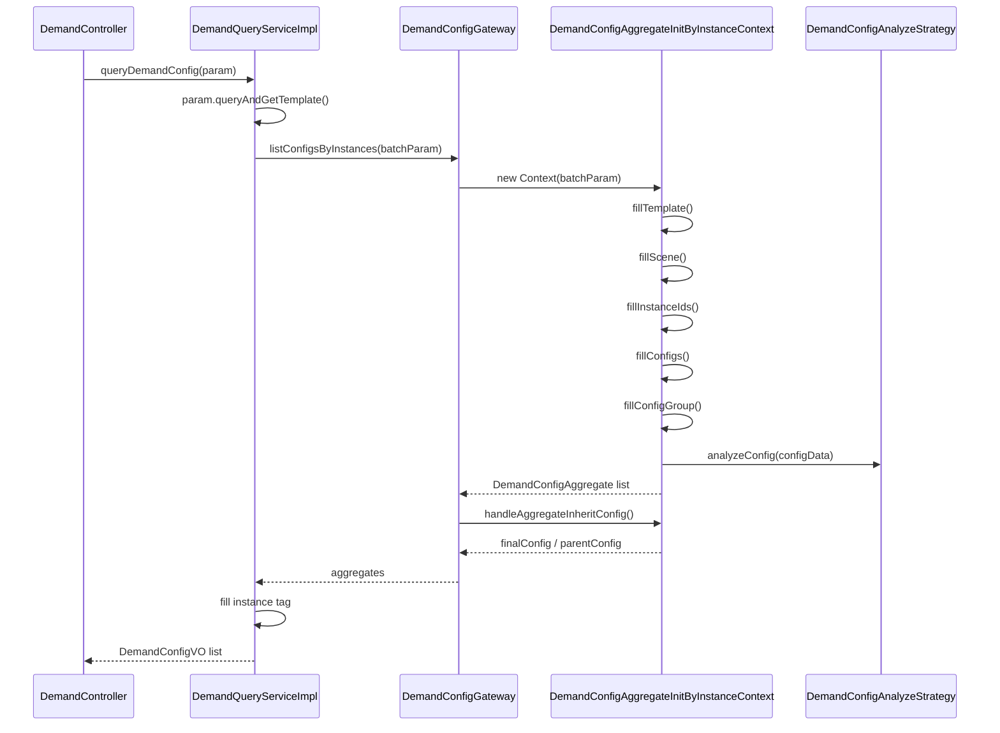

# 接口与查询流程

需求管理接口分为通用需求查询、模板日历、场景配置、实例组、空调专项、值选、黑名单和对外接口。通用查询位于 `common`，黑名单 Controller 当前位于 SaaS server。

## 通用需求接口

基础路径：`/demand`  
Controller：`DemandController`

| 方法 | 路径 | Service 方法 | 说明 |
| --- | --- | --- | --- |
| POST | `/demand/treeDemandInstance` | `treeDemandInstance` | 查询需求实例树。 |
| POST | `/demand/listInstanceConfig` | `listInstanceConfig` | 查询实例配置，如黑名单、屏蔽等。 |
| POST | `/demand/listDemandSpaceInFloor` | `listDemandSpaceInFloor` | 查询楼层下需求空间。 |
| POST | `/demand/listCustomizedConfigInstance` | `listCustomizedConfigInstance` | 查询自定义配置实例。 |
| POST | `/demand/listDemandReferenceParentSpaceByInFloor` | `listDemandReferenceParentSpaceByInFloor` | 查询引用上级配置的空间。 |
| POST | `/demand/listChildrenSpaceFuncTypes` | `listChildrenSpaceFuncTypes` | 查询实例下空间功能类型。 |
| POST | `/demand/config/listConfigsByInstance` | `queryDemandConfig` | 查询需求配置主接口。 |
| POST | `/demand/treeBuildingFloorSpace` | `treeBuildingFloorSpace` | 查询建筑、楼层、空间树。 |
| POST | `/demand/treeSpaceRoomFuncTypes` | `treeSpaceRoomFuncTypes` | 查询空间功能类型树。 |
| POST | `/demand/config/listConfigGroups` | `listConfigGroups` | 查询自定义配置分组。 |

`treeControlledObject`、`listControlledObject`、`treeShieldedObject` 仍保留但已标记 `@Deprecated`。

## 配置查询主流程

入口：`DemandController#queryDemandConfig`  
实现：`DemandQueryServiceImpl#queryDemandConfig`  
领域网关：`DemandConfigGateway#listConfigsByInstances`

主流程关键点：

- `DemandConfigQueryParam#queryAndGetTemplate` 负责按模板 ID、模板类型、日期等条件定位模板。
- 当 `instanceIds` 为空时，`DemandConfigByInstanceBatchQueryParam.autoFillEmptyInstanceIds` 会触发自动补齐实例。
- `queryInheritConfig=true` 时，网关会处理父级配置并生成 `parentConfig` 与 `finalConfig`。
- `queryInstanceTag=true` 时，Service 会继续查询实例配置和业务类型自定义标签，填充 `DemandInstanceTagVO`。
- `withColumns` 会在 VO 层裁剪输出字段。

## 模板与日历接口

基础路径：`/demand/template`  
Controller：`DemandCalendarController`

| 方法 | 路径 | 说明 |
| --- | --- | --- |
| POST | `/demand/template/listTemplateType` | 查询模板类型。 |
| POST | `/demand/template/listTemplate` | 查询模板列表。 |
| POST | `/demand/template/listDateSetting` | 查询模板日期设置。 |

基础路径：`/demand/openingCalendar`  
Controller：`DemandCommonOpeningCalendarController`

| 方法 | 路径 | 说明 |
| --- | --- | --- |
| POST | `/demand/openingCalendar/listInstantiationDateTag` | 查询实例化日期标签。 |
| POST | `/demand/openingCalendar/listAirDateTagByRule` | 查询空调日历规则下的日期标签。 |

## 场景接口

基础路径：`/demand/scene`  
Controller：`DemandSceneController`

| 方法 | 路径 | 说明 |
| --- | --- | --- |
| POST | `/demand/scene/listSceneConfig` | 查询模板下场景配置。 |
| POST | `/demand/scene/listAllScene` | 批量查询模板场景。 |
| POST | `/demand/scene/editSceneConfigs` | 编辑场景配置。 |
| POST | `/demand/scene/copySceneConfig` | 复制场景配置。 |
| POST | `/demand/scene/copySceneConfigByTemplate` | 按模板复制场景配置。 |
| POST | `/demand/scene/listExistsSceneConfigTemplate` | 查询存在场景配置的模板。 |

## 实例组接口

基础路径：`/demand/instanceGroup`  
Controller：`DemandInstanceGroupController`

| 方法 | 路径 | 说明 |
| --- | --- | --- |
| POST | `/demand/instanceGroup/treeBuildingFloorInstances` | 查询建筑、楼层、实例树。 |
| POST | `/demand/instanceGroup/list` | 查询实例组。 |
| POST | `/demand/instanceGroup/listByInstanceIds` | 按实例 ID 查询实例组。 |

## 空调和值选接口

基础路径：`/demand/airconditioning`  
Controller：`DemandAirconditioningController`

| 方法 | 路径 | 说明 |
| --- | --- | --- |
| POST | `/demand/airconditioning/getWorkConditionByShellConfigData` | 按空调壳配置查询工况。 |
| POST | `/demand/airconditioning/fixHistoryValueSelectConfig` | 兼容修复历史值选配置。 |

基础路径：`/valueSelection`  
Controller：`ValueSelectionController`

| 方法 | 路径 | 说明 |
| --- | --- | --- |
| POST | `/valueSelection/listValueSelectType` | 查询值选类型。 |
| POST | `/valueSelection/listConfigByType` | 按类型查询值选配置。 |
| POST | `/valueSelection/currentTempAndCarbonRate` | 查询当前温度和碳排系数。 |
| POST | `/valueSelection/currentApplyConfig` | 查询当前应用配置。 |
| POST | `/valueSelection/saveConfig` | 保存值选配置。 |
| POST | `/valueSelection/listElectricityData` | 查询电量趋势数据。 |
| POST | `/valueSelection/listCarbonData` | 查询碳排趋势数据。 |

## 黑名单接口

基础路径：`/demand/blacklist`  
Controller：`saas/meos-control-server/.../DemandBlacklistController.java`

| 方法 | 路径 | 说明 |
| --- | --- | --- |
| POST | `/demand/blacklist/addRules` | 保存黑名单规则。 |
| POST | `/demand/blacklist/listSpaceIdsByRule` | 按规则解析空间 ID。 |
| POST | `/demand/blacklist/query` | 查询黑名单规则配置。 |

## 对外接口

| 基础路径 | Controller | 说明 |
| --- | --- | --- |
| `/external/demand` | `DemandExternalController` | 查询外部需求实例树、需求空间、末端空间时序和值选配置。 |
| `/external/demand/config` | `ExternalDemandConfigController` | 按实例查询外部需求配置结果。 |

对外接口通常依赖 `DemandExternalService`、`ExternalDemandConfigService` 和各 `DemandStrategy#externalListConfigResultsByInstance` 实现。
