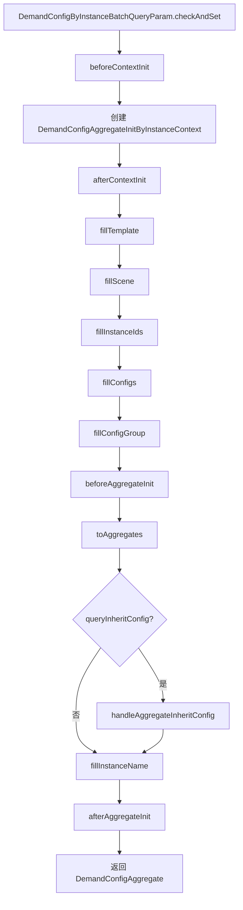

# 网关、生命周期与继承

需求配置的读取、保存、清除和复制统一由 `DemandConfigGateway` 承接。它把模板、场景、实例、配置、分组、父级配置和策略解析组合成 `DemandConfigAggregate`。

## DemandConfigGateway 职责

`DemandConfigGateway<T extends BaseDemandConfig>` 的主要方法：

| 方法 | 说明 |
| --- | --- |
| `isExistsCustomizedInstance` | 判断模板下是否存在自定义配置实例。 |
| `getByTemplate` | 根据模板参数查询模板。 |
| `getConfigByInstance` | 查询单个实例配置。 |
| `listHasConfigSpaceIds` | 查询存在最终配置的空间 ID。 |
| `listOriginConfigs` | 查询原始配置，不走完整继承输出。 |
| `listConfigsByInstances` | 批量查询实例配置，是主查询入口。 |
| `listCustomizedInstances` | 查询已自定义配置的实例。 |
| `listReferenceParentSpaces` | 查询引用上级配置的空间。 |
| `addOrUpdateConfig` | 新增或修改需求配置。 |
| `cancelReference` | 取消引用配置。 |
| `clearConfig` | 清除当前或下级配置。 |
| `copyConfig` | 复制配置。 |
| `checkConfigGroupNameExists` | 检查配置分组名称是否存在。 |

## 批量查询流程

入口：`DemandConfigGatewayImpl#listConfigsByInstances`

失败场景会通过 `context.failed` 中断流程并返回空列表。

## 初始化上下文

`DemandConfigAggregateInitByInstanceContext` 持有一次配置查询所需的上下文数据：

| 数据 | 说明 |
| --- | --- |
| `param` | 查询参数。 |
| `template` | 当前需求模板。 |
| `inheritConfigType` | 模板类型对应的继承方式。 |
| `scene` | 当前场景，可为空。 |
| `configs` | 当前实例的数据库配置，缺失时会补空配置用于继承计算。 |
| `configGroupIdAndData` | 配置分组映射。 |
| `instanceTypeAndInstanceIds` | 实例类型到实例 ID 的映射。 |
| `instanceIdAndAllParents` | 实例到所有父级实例的映射。 |
| `instanceIdAndParentAggregates` | 实例到父级聚合根的映射。 |
| `instanceAndChildrenRoomFuncTypes` | 实例到下级空间功能类型的懒加载映射。 |

上下文中会调用 `DemandTemplateRepository`、`DemandSceneRepository`、`DemandConfigRepository`、`DemandConfigGroupRepository`、`DemandInstanceRepository`、`InstanceService` 和 `DtpRwdClientService`。

## 配置继承类型

继承类型来自具体模板类型的 `DemandConfigAnalyzeStrategy#inheritConfigType()`。

| 继承类型 | 行为 |
| --- | --- |
| `OBJECT` | 当前实例有自身配置则使用自身配置，否则使用父级配置。 |
| `FIELD` | 按字段合并，自身字段为空时从父级配置补齐。 |

`DemandConfigAggregate#handleFinalConfig()` 根据继承类型生成 `finalConfig`。

## 继承模式

`DemandInheritModeEnum` 当前包括：

| 模式 | 说明 |
| --- | --- |
| `GLOBAL` | 继承父级全局配置。 |
| `ROOM_FUN_TYPE` | 继承父级空间功能类型配置。 |

对象级继承会优先尝试空间功能类型配置。若匹配不到空间功能类型配置，再回退到全局配置。

## 父级查询与默认配置

处理继承时，上下文会通过 `InstanceService#mapInstanceIdAndAllParentsByDirectQuery` 查询实例的所有父级。若父级包含项目但数据库中没有项目配置，则会读取策略的 `defaultConfig(DemandInstanceTypeEnum.PROJECT)`，在存在默认值时生成项目级父配置。

## 黑名单与屏蔽过滤

`fillInstanceIds()` 会移除无效实例。无效实例包括：

- `DemandInstanceConfigValueObject.inBlacklisted=true`
- 查询参数要求过滤屏蔽空间时，`shielded=true`

过滤查询通过 `DemandInstanceRepository#listConfig` 实现，模板类型和日期都会参与过滤。

## 生命周期

`DemandConfigLifeAware<T>` 提供配置聚合生命周期：

| 顺序 | 方法 | 阶段 |
| --- | --- | --- |
| 1 | `beforeContextInit` | 创建上下文前。 |
| 2 | `afterContextInit` | 创建上下文后。 |
| 3 | `beforeAggregateInit` | 聚合根初始化前。 |
| 4 | `afterAggregateInit` | 聚合根初始化后。 |
| 5 | `beforeAggregateHandleInheritConfig` | 处理继承前。 |
| 6 | `afterAggregateHandleInheritConfig` | 处理继承后。 |
| 7 | `beforeAddOrEdit` | 新增或编辑配置前。 |
| 8 | `afterAddOrEdit` | 新增或编辑配置后。 |

`DemandInstanceConfigLifeAware` 提供实例配置生命周期：

| 方法 | 阶段 |
| --- | --- |
| `beforeAdd` / `afterAdd` | 新增实例配置前后。 |
| `beforeEdit` / `afterEdit` | 编辑实例配置前后。 |
| `beforeDel` / `afterDel` | 删除实例配置前后。 |

生命周期实现需要实现 `Ordered`，数值越小优先级越高。实现类应尽量保持无状态。
