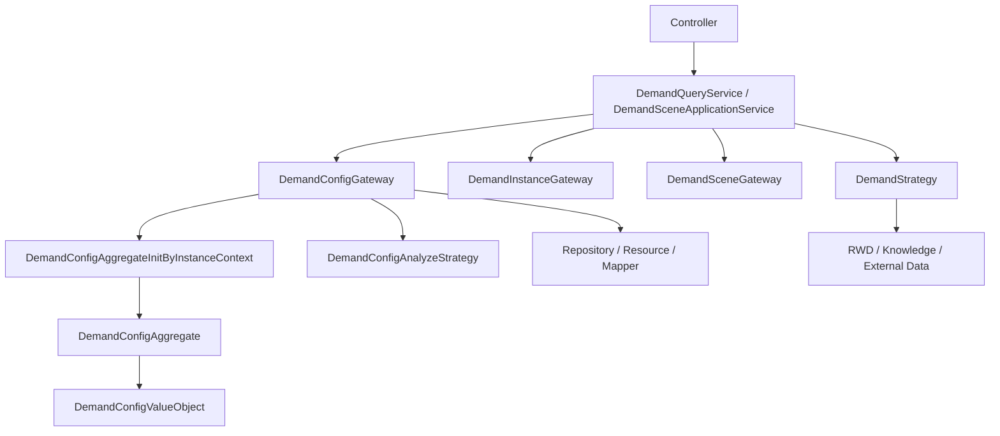

# 模块总览

需求管理模块提供“按日期和场景生效的需求配置”能力。它将模板、日历、场景、实例层级、配置数据、配置分组和业务策略组合起来，为运行监控、外部系统和 AI 场景提供需求配置查询结果。

## 模块职责

- 查询需求类型和模板类型。
- 查询模板、模板日期设置和实例化日期标签。
- 查询需求实例树、需求空间树和空间功能类型树。
- 查询、保存、清除、复制需求配置。
- 按项目、建筑、楼层、空间层级处理需求配置继承。
- 按空调、照明、安防、通风等业务类型解析配置 JSON。
- 管理需求场景、场景配置复制和模板变更联动。
- 管理需求实例配置、黑名单和屏蔽空间过滤。
- 向外部系统输出需求实例、需求空间和值选配置等数据。

## 模块边界

| 边界 | 说明 |
| --- | --- |
| API 边界 | 通用接口集中在 `/demand`、`/demand/template`、`/demand/scene`、`/demand/instanceGroup`、`/valueSelection` 等路径。 |
| 查询编排边界 | `DemandQueryServiceImpl` 负责页面查询编排和 VO 转换。 |
| 配置领域边界 | `DemandConfigGateway` 负责配置查询、保存、清除、复制、继承和聚合根构建。 |
| 实例配置边界 | `DemandInstanceGateway` 负责黑名单、屏蔽、自定义实例配置等实例级配置。 |
| 场景边界 | `DemandSceneGateway` 和 `DemandSceneApplicationService` 负责场景查询、编辑、复制和模板联动。 |
| 策略边界 | `DemandStrategy` 面向需求大类，`DemandConfigAnalyzeStrategy` 面向具体模板类型配置解析。 |

## 核心包结构

```text
common/src/main/java/com/persagy/apccontrol/basic
├── controller/demand
├── service/demand
│   ├── impl
│   ├── airconditioning
│   ├── blacklist
│   ├── instancegroup
│   └── lighting
├── model/context/demand
├── model/entity/demand
├── model/param/demand
├── model/vo/demand
├── resource/demand
├── mapper/demand
└── structure/demand
    ├── converter
    ├── enumeration
    ├── gateway
    ├── lifecycle
    ├── model
    ├── repository
    └── strategy
```

## 总体关系



## 关键概念

| 概念 | 说明 |
| --- | --- |
| 需求类型 | `DemandTypeEnum`，包括空调、照明、安防、通风、厨房排油烟。 |
| 模板类型 | `DemandTemplateTypeEnum`，如空调、公共区域照明、停车场照明、布防、通行、停车场通风等。 |
| 模板标签 | `DemandTemplateTagEnum`，如工作日、休息日、节假日、店庆日、自定义。 |
| 需求实例 | `DemandInstanceTypeEnum` + instanceId，支持项目、建筑、楼层、空间。 |
| 需求配置 | `DemandConfig` 表中的 JSON 配置，经策略解析成 `DemandConfigValueObject<T>`。 |
| 配置聚合根 | `DemandConfigAggregate<T>`，表达一个实例在某模板、日期、场景下的自身配置、父级配置和最终配置。 |
| 配置分组 | `DemandConfigGroup` / `DemandConfigGroupEntity`，用于自定义配置实例和空间功能类型配置分组。 |

## 主干设计

需求管理的核心设计是“模板选择生效配置，实例层级处理继承，策略解析业务 JSON”。Controller 不直接理解空调或照明配置细节，而是把模板类型、实例和日期传入查询服务；查询服务再通过网关生成聚合根；聚合根根据模板类型策略解析配置，并在上下文中处理继承后输出最终配置。
