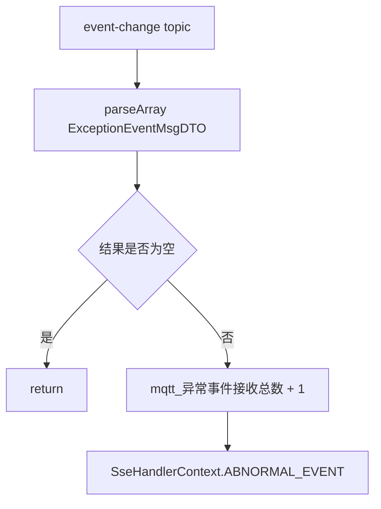

# 业务事件消息

边缘 MQTT 除 Twin 点位消息外，还接收异常事件、风险事件和 DTP-MEOS 业务消息。这些消息都由 `MqttReceiveServiceImpl` 按 topic 分流，再交给 SSE 策略或业务服务处理。

## 消息分类

| topic | payload 模型 | 接收方法 | 下游 |
| --- | --- | --- | --- |
| `${mqtt.topic.event-change.name}` | `List<ExceptionEventMsgDTO>` | `eventChange` | `SseEmitterEventEnum.ABNORMAL_EVENT` |
| `${mqtt.topic.danger-event.name}` | `DangerEventMsgDTO` | `dangerEvent` | `SseEmitterEventEnum.DANGER_EVENT` |
| `${mqtt.topic.dtp-meos.name}` | `BusinessExternalPushDTO` | `dtpMeosServerEdge` | `DtpMeosServerEdgeService` |

这些 topic 只在边缘端 MQTT 接入层消费。SaaS 不实现对应 MQTT 消费入口。

## 异常事件

异常事件分支解析 payload 为 `List<ExceptionEventMsgDTO>`：



维护要点：

- 异常事件 payload 当前要求是数组。
- 接收层只做解析和 SSE 分发，不在这里持久化异常事件。
- SSE 订阅过滤和前端展示由对应 SSE 策略维护。

## 风险事件

风险事件分支解析 payload 为 `DangerEventMsgDTO`。解析前会执行：

```java
message.getPayload().replace("@type", "type")
```

这是为了兼容 payload 中的 `@type` 字段。维护要点：

- 如果风险事件模型字段发生变化，先确认是否仍需要 `@type` 兼容。
- 风险事件解析为空时直接返回。
- 后续通过 `SseEmitterEventEnum.DANGER_EVENT` 推送。

## DTP-MEOS 业务消息模型

`BusinessExternalPushDTO` 包含：

| 字段 | 说明 |
| --- | --- |
| `groupCode` | 集团编码。 |
| `projectId` | 项目 ID。 |
| `businessType` | 业务消息类型，枚举为 `BusinessTypeEnum`。 |
| `content` | 业务消息实体，不同类型对应不同结构。 |

`MqttReceiveServiceImpl#dtpMeosServerEdge` 只负责解析和转交，真正分支在 `DtpMeosServerEdgeService#dtpMeosServerEdge`。

## DTP-MEOS 分支

`DtpMeosServerEdgeService` 当前支持：

| `BusinessTypeEnum` | content 处理 | 下游动作 |
| --- | --- | --- |
| `RUNNING_LOG` | `RcRunningLog` | `RunningLogEdgeService#saveLog` |
| `LIGHT_DEMAND_CHANGE` | 无需 content | 触发 `LIGHT_DEMAND_CHANGE` 和 `LIGHT_LOOP` SSE |
| `RELEASE_INTERVENTION` | `ReleaseInterventionDTO` | `SseEmitterEdgeServer#releaseIntervention` |
| `RUN_CONSOLE_DEMAND_CHANGE` | JSON 数组 | 逐条转为控制台扩展消息并触发 `INFO_EXTEND_SET` |
| `RUN_CONSOLE_DEMAND_CHANGE_SWITCH_SET` | JSON 数组 | 逐条转为控制台扩展消息并触发 `INFO_EXTEND_SET` |
| `BUSINESS_RUNNING_LOG` | `BusinessRunningLogPushDTO` | `RunningLogEdgeNowService#saveByBdtpMsg` |

未识别的业务类型进入 `default`，当前不处理。

## 控制台扩展消息

`chillersControlConsoleMsg` 将业务消息中的对象字段包装为 `FeedbackInfoMsgMqttVO`：

| 字段 | 来源 |
| --- | --- |
| `classCode` | content JSON 的 `classCode` |
| `systemId` | content JSON 的 `systemId` |
| `objectId` | content JSON 的 `objectId` |
| `modelType` | `BusinessTypeEnum#getValue` |
| `projectId` | `ContextUtil.getProjectId()` |
| `extendSetting` | 原始业务消息 |

随后触发 `SseEmitterEventEnum.INFO_EXTEND_SET`，用于边缘页面刷新扩展设置。

## 运行日志业务消息

DTP-MEOS 业务消息中有两类日志相关能力：

| 类型 | 说明 |
| --- | --- |
| `RUNNING_LOG` | 将 content 解析为旧版 `RcRunningLog` 并保存。 |
| `BUSINESS_RUNNING_LOG` | 将 content 解析为 `BusinessRunningLogPushDTO`，由新版日志服务保存。 |

这些消息的来源可以是运行组或控制组上报的数据。边缘 MQTT 只负责接收和分发，日志模块负责日志记录的分类、展示和查询。

## 异常处理

`DtpMeosServerEdgeService#dtpMeosServerEdge` 使用整体 `try/catch` 包裹业务分支，异常时记录：

```text
收到dtpMeosServerEdge的mqtt数据-执行错误
```

维护时需要注意：

- 单个业务类型解析失败会被 catch 捕获，不会继续抛到 MQTT 接收层。
- 新增业务类型时应对 `content == null` 做显式保护。
- 如果业务消息需要幂等、重试或持久化，需要在业务服务内部设计，不依赖 MQTT 接收层重放。

## 维护要点

- 新增 `BusinessTypeEnum` 后，必须同步 `DtpMeosServerEdgeService` 分支和 content 模型。
- 控制相关业务消息只描述“边缘收到后如何转交”，不要在 MQTT 文档中扩展控制动作执行设计。
- 日志相关业务消息要同步运行日志设计文档，避免 MQTT 文档成为日志分类和查询规则的维护入口。
- SSE 分支新增时，需要确认订阅类型、项目上下文和前端消费协议。
