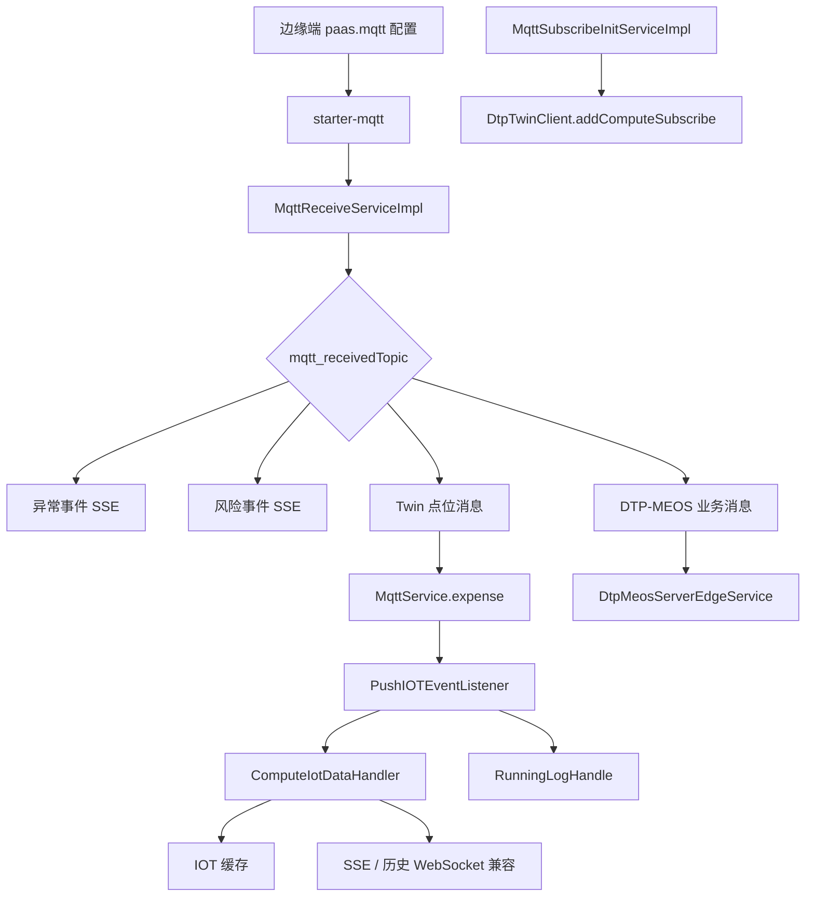

# 模块总览

边缘 MQTT 模块是边缘端与 MQTT broker、Twin 服务和边缘内部消费链路之间的接入层。它负责把外部推送的 topic 消息转换为边缘内部可消费的点位数据、事件数据或业务消息，然后交给 IOT 缓存、SSE、运行日志等模块处理。历史 WebSocket 类名和少量转调逻辑只作为兼容边界保留。

## 模块职责

- 启用 `starter-mqtt` 并读取 `paas.mqtt` 配置，建立边缘端 MQTT 接收能力。
- 在系统初始化时向 DTP Twin 注册边缘计算服务需要订阅的对象类。
- 接收单条或批量 MQTT 消息，并根据 `mqtt_receivedTopic` 分流。
- 将 Twin 点位消息转换为 `FeedbackInfoMsgMqttVO`，区分反馈值和控制值。
- 触发边缘侧 IOT 数据计算、缓存写入、SSE 推送和运行日志更新。
- 承接异常事件、风险事件和 DTP-MEOS 业务消息。
- 提供边缘端模拟发数、批量发数和消费统计观测接口。

## 模块边界

| 边界 | 说明 |
| --- | --- |
| 接入边界 | MQTT 只在边缘端存在，入口在 `local/meos-control-compute-edge`。 |
| SaaS 边界 | SaaS 不配置、不订阅、不消费 MQTT，也不实现 `MqttReceiveService`。 |
| 公共依赖边界 | `local/meos-control-common-edge` 提供边缘公共模型、接口、缓存和日志能力，不是 SaaS MQTT 接入层。 |
| Twin 边界 | `MqttSubscribeInitServiceImpl` 只负责告诉 Twin 需要订阅的对象类，不负责 Twin 内部规则生成。 |
| 控制边界 | 控制服务可以通过 `dtp-meos` topic 上报业务消息，但控制动作执行与控制状态机不归 MQTT 模块维护。 |
| 日志边界 | MQTT 消费链路会触发运行日志更新或保存，日志分类、查询、导出和展示由运行日志模块维护。 |
| 历史代码边界 | 本文档聚焦当前 MQTT 接入和消费主链路，其他使用 `FeedbackInfoMsgMqttVO` 的旧查询能力只视为下游缓存消费者。 |

## 总体链路



## 核心包结构

```text
local/meos-control-compute-edge/src/main/java/com/persagy/apccontrol
├── init
│   └── MqttSubscribeInitServiceImpl.java
├── mq
│   └── MqttReceiveServiceImpl.java
├── service
│   ├── DtpMeosServerEdgeService.java
│   ├── handler/RunningLogHandle.java
│   └── impl/MqttServiceImpl.java
├── websocket
│   ├── event/PushIOTEventListener.java
│   └── handler/ComputeIotDataHandler.java
├── controller/MqttController.java
└── util/mqtt/MqttCounter.java
```

```text
local/meos-control-common-edge/src/main/java/com/persagy/apccontrol/common
├── service/MqttService.java
├── model/excel/FeedbackInfoMsgMqttExcelListener.java
└── outside/model/dto/MqttSubscribe.java
```

## 当前主干设计

当前主干是“边缘 MQTT 接收，按 topic 分流，点位数据进入 IOT 消费链路，业务消息进入对应业务服务”。接入层只做必要的上下文设置、topic 判断、基础解析和无效值过滤，复杂业务逻辑由后续边缘服务承接。

后续维护时，优先判断变更属于哪一层：

- broker、topic、线程池、证书或认证参数变更，进入配置与订阅文档。
- 消息进入哪个处理分支，进入接收与分流文档。
- 点位数据如何落缓存、推前端、触发日志，进入 Twin 点位消费和 IOT 缓存推送文档。
- 运行日志分类和查询展示，进入运行日志设计文档。
- 控制动作执行和控制策略，进入控制组对应设计，不在 MQTT 模块扩展。
