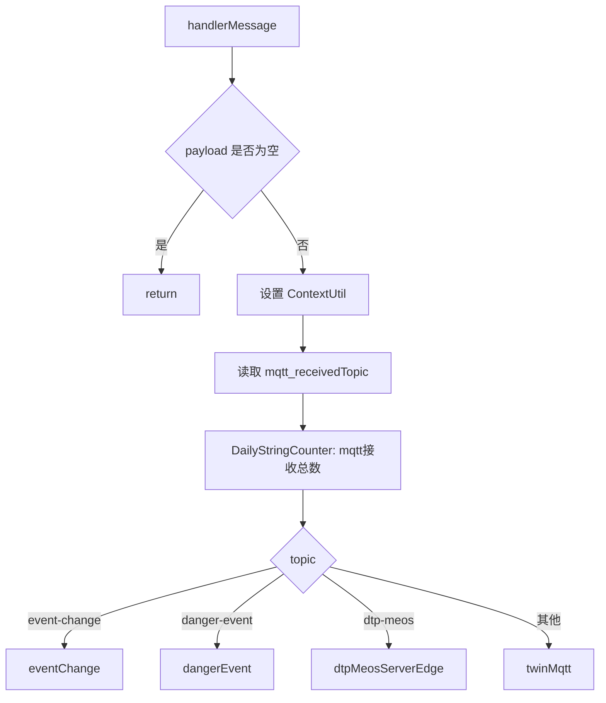

# 接收与分流

`MqttReceiveServiceImpl` 是边缘 MQTT 消息接收入口，实现 `com.persagy.framework.mqtt.service.MqttReceiveService`。starter-mqtt 收到消息后，通过单条或批量方法回调该服务。

## 接收入口

| 方法 | 说明 |
| --- | --- |
| `receiveValue(Message<String> message)` | 单条 MQTT 消息处理入口。 |
| `receiveValues(List<Message<String>> messageList)` | 批量 MQTT 消息处理入口，内部逐条调用 `handlerMessage`。 |
| `handlerMessage(Message<String> message)` | 统一处理入口，负责校验、上下文设置、topic 分流。 |

单条和批量入口保持一致的处理逻辑，避免不同消费模式产生行为差异。

## 上下文设置

`handlerMessage` 对非空 payload 设置边缘项目上下文：

| 上下文 | 来源 |
| --- | --- |
| `ContextUtil.projectId` | `ProjectCfg#getProjectId` |
| `ContextUtil.groupCode` | `ProjectCfg#getGroupCode` |
| `ContextUtil.tenant` | `ProjectCfg#getGroupCode` |

这些上下文用于后续 SSE、日志、缓存和业务服务。新增接收分支时，不要绕过 `handlerMessage` 直接消费消息，否则容易丢失项目和集团上下文。

## topic 获取

接收服务通过消息头读取真实接收 topic：

```java
message.getHeaders().get("mqtt_receivedTopic", String.class)
```

随后将 topic 与配置项比较：

| 字段 | 配置 | 分支 |
| --- | --- | --- |
| `compute` | `${mqtt.topic.meos-compute.name}` | Twin 反馈值。 |
| `eventChange` | `${mqtt.topic.event-change.name}` | 异常事件。 |
| `dangerEvent` | `${mqtt.topic.danger-event.name}` | 风险事件。 |
| `dtpMeosServerEdge` | `${mqtt.topic.dtp-meos.name}` | DTP-MEOS 业务消息。 |
| 其他已订阅 topic | `receive-topics` 中其他 topic | Twin 控制值。 |

## 分流流程



## 异常事件分支

`eventChange` 将 payload 解析为 `List<ExceptionEventMsgDTO>`：

1. payload 为空或解析结果为空时返回。
2. 计数器 `mqtt_异常事件接收总数` 加一。
3. 调用 `SseHandlerContext#getStrategy(SseEmitterEventEnum.ABNORMAL_EVENT)`。
4. 执行 `doOperation(projectId, exceptionEventMsgs)` 推送异常事件。

异常事件只在边缘接收和分发，事件模型与 SSE 策略由公共能力承接。

## 风险事件分支

`dangerEvent` 的 payload 会先把 `@type` 替换为 `type`，再解析为 `DangerEventMsgDTO`：

1. payload 字段名兼容处理。
2. 解析为空时返回。
3. 调用 `SseHandlerContext#getStrategy(SseEmitterEventEnum.DANGER_EVENT)`。
4. 执行 `doOperation(projectId, dangerEventMsgDTO)` 推送风险事件。

## DTP-MEOS 业务消息分支

`dtpMeosServerEdge` 将 payload 解析为 `BusinessExternalPushDTO`：

1. 解析为空时返回。
2. 计数器 `mqtt_dtp_meos接收总数` 加一。
3. 调用 `MqttService#dtpMeosServerEdge`。
4. 由 `DtpMeosServerEdgeService` 按业务类型继续处理。

该分支用于边缘端承接业务消息，不表示 MQTT 模块维护业务消息对应的控制动作或日志查询。

## Twin 点位分支

`twinMqtt` 负责把 Twin 点位 payload 解析为 `FeedbackInfoMsgMqttVO`：

1. payload 解析为 JSON。
2. 使用 `CommonConst.JSON_MAPPER` 转换为 `FeedbackInfoMsgMqttVO`。
3. 补充 `projectId` 和 `groupCode`。
4. 如果 `dataValue` 为空或为 `~`，视为无效消息并返回。
5. topic 等于 `meos-compute` 时设置 `type=FEEDBACK`。
6. 其他 topic 设置 `type=CTRL`。
7. 设置 `webType=WebSocketTypeEnum.PARAM_SET`。
8. 调用 `MqttService#expense` 进入边缘 IOT 消费链路。

## 计数器

| 计数器 | 增加位置 |
| --- | --- |
| `mqtt接收总数` | 每条有效 payload 进入 `handlerMessage`。 |
| `mqtt_异常事件接收总数` | 异常事件解析成功后。 |
| `mqtt_dtp_meos接收总数` | DTP-MEOS 业务消息解析成功后。 |
| `mqtt反馈值` | Twin 点位识别为反馈值后。 |
| `mqtt控制值总数` | Twin 点位识别为控制值后。 |

计数器用于边缘现场排查吞吐和分支命中情况，不作为业务一致性依据。

## 维护要点

- 新增 topic 分支时，要在 `paas.mqtt.receive-topics` 和 `MqttReceiveServiceImpl` 中同时处理。
- 新分支应先完成 payload 空值和解析空值保护，再进入业务服务。
- 点位消息的无效值过滤集中在接收层，避免无效 `~` 进入缓存和日志。
- 如果 topic 不在特殊分支中，当前逻辑会按 Twin 控制值处理；新增 topic 时要确认是否适合这个默认规则。
