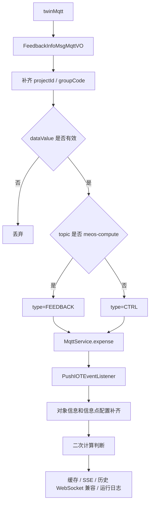

# Twin 点位消费

Twin 点位消息是边缘 MQTT 的核心消费内容。`MqttReceiveServiceImpl#twinMqtt` 将 MQTT payload 转换为 `FeedbackInfoMsgMqttVO`，再通过 `MqttService#expense` 进入边缘 IOT 消费链路。

## 数据模型

`FeedbackInfoMsgMqttVO` 位于 `common/src/main/java/com/persagy/apccontrol/basic/model/vo/FeedbackInfoMsgMqttVO.java`，是边缘侧 IOT 点位数据的通用承载对象。

关键字段：

| 字段 | 说明 |
| --- | --- |
| `projectId` / `groupCode` | 边缘项目和集团上下文，接收层会补齐。 |
| `id` / `traceData` | 消息或链路追踪字段。 |
| `systemId` | 对象所属系统或模块信息，后续对象信息补齐时使用。 |
| `objectId` | RWD 对象实例 ID。 |
| `localId` / `localName` | 对象本地编码和名称，由边缘缓存补齐。 |
| `objType` / `modelType` | 对象类型和所属模块，由对象业务字段补齐。 |
| `classCode` | 对象类编码。 |
| `infoCode` | 信息点编码。 |
| `dataTime` | 上报时间，格式为 `yyyyMMddHHmmss`。 |
| `dataValue` | 点位值，空值或 `~` 在接收层丢弃。 |
| `dataValueName` | 枚举值名称，由信息点配置补齐。 |
| `dataStatus` | 反馈值或控制值状态。 |
| `invalid` | 反馈值有效标志。 |
| `forced` | 控制点强制状态。 |
| `result` | 控制结果状态。 |
| `dataIndate` | 数据有效时长。 |
| `cmdLevel` | 控制指令等级，`8` 表示人工，`12` 表示自动。 |
| `type` | IOT 数据类型，反馈值为 `FEEDBACK`，控制值为 `CTRL`。 |
| `webType` | 页面传输类型，MQTT 接收默认设为 `PARAM_SET`。 |
| `extendSetting` | 业务消息扩展载体。 |

## 类型识别

`MqttReceiveServiceImpl#twinMqtt` 通过 topic 判断点位类型：

| 条件 | 设置 |
| --- | --- |
| `receivedTopic == mqtt.topic.meos-compute.name` | `type=EnumIotDataType.FEEDBACK` |
| 其他 Twin 点位 topic | `type=EnumIotDataType.CTRL` |

该判断依赖 topic 语义。新增 topic 时需要明确它是反馈值、控制值还是独立业务消息，避免默认进入控制值分支。

## 消费接口

`MqttService` 定义两个边缘消费方法：

| 方法 | 说明 |
| --- | --- |
| `expense(FeedbackInfoMsgMqttVO vo)` | 消费 Twin 点位数据。 |
| `dtpMeosServerEdge(BusinessExternalPushDTO vo)` | 消费 DTP-MEOS 业务消息。 |

实现类 `MqttServiceImpl` 做空值保护后分发：

| 方法 | 下游 |
| --- | --- |
| `expense` | `PushIOTEventListener#onApplicationEvent` |
| `dtpMeosServerEdge` | `DtpMeosServerEdgeService#dtpMeosServerEdge` |

`MqttService` 位于 `local/meos-control-common-edge`，是为了让边缘公共代码引用消费接口；实际实现仍在 `local/meos-control-compute-edge`。

## IOT 消费监听

`PushIOTEventListener#onApplicationEvent` 是点位数据进入边缘业务链路后的统一编排点：

1. 根据 `classCode + infoCode` 从 `LocalRedisCacheHandler#getInfoCodeConfig` 获取信息点配置。
2. 根据 `groupCode + projectId + objectId` 获取对象业务字段和系统信息。
3. 回填 `localId`、`localName`、`objType`、`modelType`。
4. 调用 `ComputeIotDataHandler#checkComputeInfoCodeDataCondition` 判断是否需要二次计算。
5. 需要计算时调用 `computeInfoCodeData`，否则直接使用原消息。
6. 调用 `ComputeIotDataHandler#pushMessage` 写缓存，并经过历史兼容推送链路。
7. 对结果列表逐条调用 `ComputeIotDataHandler#sseStrategy`。
8. 调用 `RunningLogHandle#handleLog` 衔接运行日志。

## 消费流程

## 与运行日志的关系

点位消息消费完成后会调用 `RunningLogHandle#handleLog`。当前日志处理只对控制值继续处理：

- 非控制值直接返回。
- 控制值会先调用 `RunningLogEdgeNowService#updateByTwinMsg` 更新新版日志状态。
- 满足完成状态、枚举值可映射、业务字段可识别时，会通过 `RunningLogEdgeService#saveLog` 写入旧版运行日志。

运行日志的分类、查询、导出和展示不在 MQTT 模块维护，详见 [运行日志程序设计文档](../running-log/README.md)。

## 维护要点

- `FeedbackInfoMsgMqttVO` 新增字段时，要检查 JSON alias、模拟发数 Excel、缓存写入、SSE、历史 WebSocket 兼容链路和运行日志是否需要同步。
- 点位值格式转换应优先在接收层或 `ComputeIotDataHandler` 中统一处理，避免多个下游重复判断。
- `MqttServiceImpl` 当前只做分发，不承载业务规则；新增业务规则应放到明确的下游服务。
- 控制值和反馈值的区分依赖 topic，调整 topic 语义时必须同步修改接收分流。
