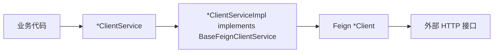

# ClientService 防腐层

## 核心规则

Feign 调用必须经过 `ClientService` 防腐层：

禁止业务代码直接注入或调用 Feign `*Client`。原因是外部接口一旦调整路径、字段、包装结构或错误码，直接依赖 `*Client` 的业务代码都会被牵动。

## 三层职责

| 对象 | 职责 | 面向对象 |
| --- | --- | --- |
| `*Client` | 声明外部 HTTP 协议，包括 `@FeignClient`、URL、路径、请求头、请求体和外部响应。 | 外部服务协议。 |
| `*ClientService` | 定义系统内部可使用的业务语义方法。 | 业务代码。 |
| `*ClientServiceImpl` | 调用 `*Client`，做参数/响应转换、兼容、默认值、异常和日志。 | 系统内部稳定模型。 |

## 模型转换

`ClientService` 层可以定义内部稳定模型，用来隔离外部响应变化：

| 转换点 | 示例 |
| --- | --- |
| 入参转换 | 业务参数转换为外部 `param`、`criteria`、`queryMap` 或 JSON。 |
| 响应转换 | `DtpRwdObjectResponse` 转 `DtpRwdObjectDTO`。 |
| 字段兼容 | 外部响应字段重命名时，在实现层兼容新旧字段。 |
| 包装兼容 | 外部 `CustomerResponse`、`R`、`DmpResult` 等响应包装在实现层统一拆包。 |
| 默认值 | 空响应转换为空列表、空 Map、null 或业务默认对象。 |

## `BaseFeignClientService`

`*ClientService` 必须实现 `com.persagy.apccontrol.basic.outside.BaseFeignClientService`，`*ClientServiceImpl` 复用以下能力：

| 方法 | 用途 |
| --- | --- |
| `getGroupCode()`、`getProjectId()` | 从 `ContextUtil` 获取默认上下文。 |
| `getOne()` | 从列表中取单条；历史重载中包含旧的空结果抛错开关。 |
| `query()`、`queryCount()` | 统一查询类调用、空结果、默认值和日志；历史重载中的布尔开关不作为新增设计参考。 |
| `insert()`、`update()`、`delete()`、`operation()` | 统一操作类调用和操作类型日志。 |
| `baseOperation()` | 捕获 `FeignException`，记录 RPC 入参、响应、上下文和异常。 |

## 维护要求

- 新增 Feign 方法时，同步新增或扩展对应 `*ClientService` 方法。
- 新增或改造 Feign 调用时，先确认 `*ClientService` 已实现 `BaseFeignClientService`。
- 调用方需要的数据结构优先定义在系统内部 DTO，不直接把外部响应对象扩散到业务层。
- 新增方法不再引入 `isThrows`、`isCache`、`queryCache` 这类布尔开关。
- 历史代码若直接调用 `*Client`，只能作为历史现状保留；新增或改造时必须收敛到 `*ClientService`。
- 如果外部接口不可用或当前运行侧不支持，应在 `*ClientServiceImpl` 中显式抛出不支持异常。
