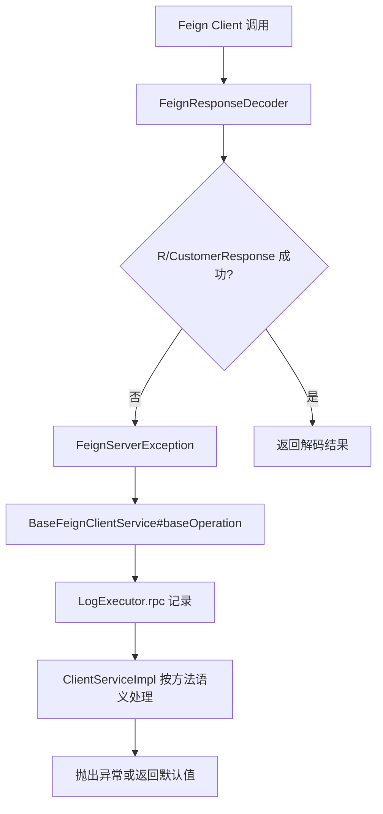

# 失败边界与观测

Feign 调用面对的是跨进程、跨网络、跨部署的外部 HTTP 接口。失败处理要明确“是否阻断主流程”“是否允许空结果”“是否需要补偿”和“如何排查”。

## 失败处理当前约定

新增 Feign 调用不再通过 `isThrows` 这类布尔参数决定是否抛错。当前设计应在 `ClientService` 方法语义中直接表达失败策略：

| 方法语义 | 失败处理 |
| --- | --- |
| 必须成功的操作 | 失败直接抛出业务异常或保留 Feign 异常，调用方中断流程。 |
| 可降级的查询 | 记录日志，返回空列表、空 Map、null 或明确的默认对象。 |
| 兼容历史接口 | 在 `ClientServiceImpl` 内部兼容旧响应和旧字段，不把兼容逻辑暴露给业务层。 |

页面聚合和列表查询通常可以返回空集合；配置初始化、关键操作和数据同步通常应失败即暴露。这个判断应通过方法命名、返回类型和实现逻辑表达，而不是通过调用方传入布尔开关。

## 通用异常链路

## 默认返回

| 场景 | 默认返回 |
| --- | --- |
| 列表查询 | `ArrayList::new`、`Lists.newArrayList()` |
| Map 查询 | `HashMap::new`、`Collections::emptyMap` |
| 单对象查询 | `null` 或 `Optional.empty()` |
| 数量查询 | `null` 或外层指定默认值 |
| 操作类调用 | 成功返回 content，失败按方法语义抛出异常或返回明确默认值。 |

默认值能降低调用方判空成本，但也可能掩盖外部接口不可用。关键链路不要为了“页面不报错”而把所有异常吞成空集合。

## 日志观测

| 组件 | 观测内容 |
| --- | --- |
| `RequestCustomHeaderInterceptor` | TRACE 下打印请求 URL、headers、body。 |
| `FeignResponseDecoder` | 打印响应成功/失败、URL、headers、耗时、必要时请求体和响应体。 |
| `BaseFeignClientService` | 操作失败时记录 groupCode、projectId、请求参数、响应内容和异常。 |
| `LogExecutor.rpc` | 统一 RPC 日志格式。 |

排查 Feign 调用时，优先按 `logTag`、URL、groupCode、projectId、requestTimestamp、executeTime 追踪。

## 请求统计

`FeignRequestStatisticsInterceptor` 在配置开启后对指定服务进行调用统计。

| 配置 | 说明 |
| --- | --- |
| `persagy.feign.request-statistics.enabled` | 是否开启统计。 |
| `persagy.feign.request-statistics.service-names` | 需要统计的 Feign target name 列表。 |
| `persagy.feign.request-statistics.redis-key` | Redis 统计 Key 前缀，默认 `feign::request-statistics`。 |

统计逻辑会从调用堆栈中找到第一个非 `basic.outside` 的业务类，按“类名.方法名:行号”计数，Key 按小时过期 24 小时。

## 历史字段边界

旧代码中仍可见 `isThrows`、`isCache`、`queryCache` 等参数或同类缓存开关。这些字段属于历史兼容边界，不作为新增 Feign 调用的设计方式。

| 历史字段 | 当前处理 |
| --- | --- |
| `isThrows` | 不在新增方法入参中继续使用；失败策略由方法语义和实现决定。 |
| `isCache`、`queryCache` | 不在新增方法入参中继续使用；是否缓存由专门的缓存设计或实现内部策略决定。 |

维护历史方法时可以保留这些参数以兼容调用方，但新增接口不要继续扩散。

## 重试边界

显式重试需要在 Feign 客户端或调用封装中清楚标注。新增关键 Feign 调用时，如果需要重试，必须明确：

- 哪些异常允许重试。
- 最大重试次数和退避策略。
- 调用是否幂等。
- 多次执行是否会产生重复数据或重复指令。
