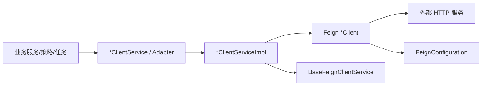

# 模块总览

## 设计目标

Feign 调用模块的目标是把外部 HTTP 接口变化隔离在调用封装层，让业务代码面向稳定的系统内部接口。

## 分层职责

| 层次 | 职责 |
| --- | --- |
| 业务层 | 使用业务语义调用能力，例如查询 RWD 对象、查询工作历、读取 Twin 当前值。 |
| `*ClientService` | 对业务层暴露稳定接口，定义系统内部入参、响应和语义。 |
| `*ClientServiceImpl` | 调用 Feign `*Client`，完成参数转换、响应转换、默认值、日志和异常处理。 |
| Feign `*Client` | 只声明服务名、URL、路径、请求头、请求体和外部响应类型。 |
| Feign 基础设施 | 统一日期转换、请求头透传、Token 注入、响应解码、调用日志和统计。 |

## 典型调用域

| 调用域 | 典型 ClientService | 底层 Feign Client |
| --- | --- | --- |
| RWD 物理世界 | `DtpRwdClientService` | `DtpRwdClient` |
| Knowledge 知识库 | `DtpKnowledgeClientService` | `DtpKnowledgeServerClient` |
| 权限/项目 | `MidPermissionClientService` | `MidPermissionClient` |
| 工作历 | `MidCalendarClientService` | `MidCalendarClient` |
| Twin | `DtpTwinClientService` | 边缘端 `DtpTwinClient` |
| Persist/IOT | `DtpPersistServerClientService`、`AbstractDtpPersistServer` | `DtpPersistServerClient` |
| 关系图/文件 | `DtpRelationalGraphClientService`、`SystemGraphExternalService` | `DtpRelationalGraphClient`、`DmpFileServiceClient` |
| 天气/能耗/事件 | `WeatherClientService`、`EnergyQualityServerService`、`ExceptionEventClientService` | 对应 Feign `*Client` |

底层 Feign Client 只允许由对应 `*ClientServiceImpl` 调用，不作为业务侧依赖。`*ClientService` 需要实现 `BaseFeignClientService`。如果现有代码仍有业务逻辑直接调用 Feign `*Client`，视为历史写法；新增或改造时必须先补 `*ClientService` 方法，再由业务侧调用。

## 设计边界

- 本文档只写 Feign 调用设计。
- 外部 HTTP 服务内部业务逻辑不在本文档维护。
- 非 Feign 的接入方式后续单独研究和补充。
- 控制相关接口只在本文档描述 Feign 调用边界，不把控制执行逻辑并入本文档。
