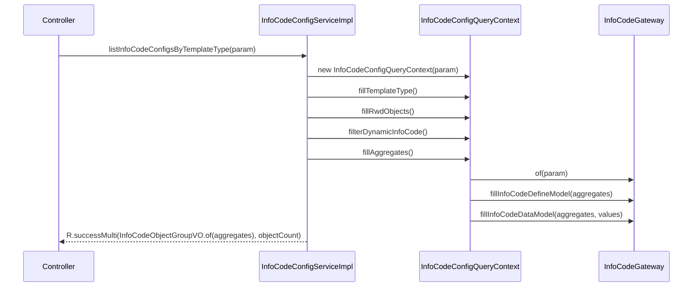
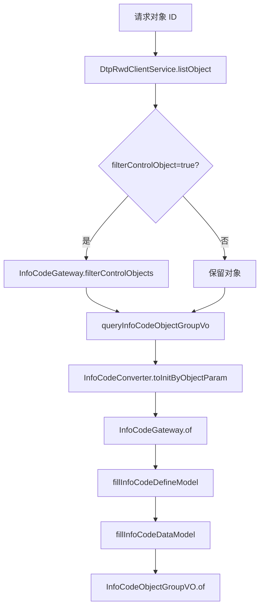

# 接口与查询流程

本模块的新接口统一由 `InfoCodeConfigController` 暴露，基础路径为 `/infoCodeConfig`。旧版接口由 `OldInfoCodeConfigController` 暴露，基础路径为 `/equipment/infoCodeConfig`，用于兼容历史调用方。

## 新版接口

| 方法 | 路径 | Service 方法 | 说明 |
| --- | --- | --- | --- |
| POST | `/infoCodeConfig/listTemplateTypes` | `listTemplateTypes` | 查询模板类型列表，支持是否查询对象数量。 |
| POST | `/infoCodeConfig/listObjectIotInfoCodesWithRuleByTemplateType` | `listObjectIotInfoCodesWithRuleByTemplateType` | 查询模板类型下存在 IOT 规则的信息点定义。 |
| POST | `/infoCodeConfig/listOriginInfoCodeConfigs` | `listOriginInfoCodeConfigs` | 查询原始信息点配置。 |
| POST | `/infoCodeConfig/listInfoCodeConfigsByTemplateId` | `listInfoCodeConfigsByTemplateType` | 按模板 ID 查询信息点配置。 |
| POST | `/infoCodeConfig/listInfoCodeConfigsByTemplateType` | `listInfoCodeConfigsByObjectFilters` | 按模板类型、对象过滤条件查询信息点配置。 |
| POST | `/infoCodeConfig/listInfoCodeConfigsByObjectId` | `listInfoCodeConfigsByObject` | 按对象 ID 查询信息点配置。 |
| POST | `/infoCodeConfig/treeTemplateType` | `treeTemplateType` | 查询模板类型的建筑/楼层树。 |

## 按模板查询配置

入口：`InfoCodeConfigServiceImpl#listInfoCodeConfigsByTemplateType`

关键点：

- `fillTemplateType()` 通过 `InfoCodeTemplateTypeResource#get` 获取模板类型。
- `fillRwdObjects()` 将模板条件转为 `InfoCodeObjectQueryParam`，再调用 `InfoCodeGateway#listTemplateTypeObjects`。
- `filterDynamicInfoCode()` 会根据动态信息点过滤条件查询 IOT 值，不满足条件的对象会被移除。
- `fillAggregates()` 生成聚合根，并继续填充定义和值。

## 按对象查询配置

入口：`InfoCodeConfigServiceImpl#listInfoCodeConfigsByObject`

`queryInfoCodeObjectGroupVo` 是按对象查询的核心私有方法。它会把 `InfoCodeConfigByObjectQueryParam` 转成 `InfoCodeInitByObjectParam`，并把对象集合写入初始化参数。值填充时会把请求中的时间条件、条件参数和 `placeholders` 放入 `additionalDataValues`，供策略层读取。

## 模板列表查询

入口：`InfoCodeConfigServiceImpl#listTemplateTypes`

查询路径由 `notQueryObjectCount` 和 `filterObjectIds` 决定：

| 条件 | 行为 |
| --- | --- |
| `notQueryObjectCount=true` 且没有 `filterObjectIds` | 直接调用 `InfoCodeGateway#listTemplateTypes` 查询模板配置。 |
| 需要对象数量或存在 `filterObjectIds` | 调用 `InfoCodeGateway#listTemplateTypesWithObjects`，同时查询模板关联对象。 |

无论哪条路径，查询到模板类型后都会调用 `InfoCodeGateway#fillInfoCodeTemplateTypeModel` 补充模板信息，再转换为 `InfoCodeTemplateVO`。

## IOT 规则信息点查询

入口：`InfoCodeConfigServiceImpl#listObjectIotInfoCodesWithRuleByTemplateType`

该流程用于查询模板类型下“存在 IOT 规则”的信息点定义：

1. 校验请求参数并读取模板类型。
2. 构造 `InfoCodeConfigQueryContext`。
3. 填充模板类型和 RWD 对象。
4. 转为 `InfoCodeInitByObjectParam`，写入 `groupCodes` 和 `infoCodeTypes`。
5. 调用 `InfoCodeGateway#of` 生成聚合根。
6. 调用 `fillInfoCodeDefineModel` 填充定义。
7. 按 `infoCode` 去重，并按配置顺序返回 `InfoCodeDefineModel`。

## 原始配置查询

入口：`InfoCodeConfigServiceImpl#listOriginInfoCodeConfigs`

该接口面向配置查看，不依赖真实对象实例。流程是先查询模板类型，再使用 `InfoCodeInitByObjectParam.ofVirtualObject(templateTypeModel)` 构造虚拟对象上下文，并调用 `InfoCodeGateway#ofOrigin` 生成原始聚合数据。

## 旧版接口兼容

旧版接口位于 `/equipment/infoCodeConfig`，由 `OldInfoCodeConfigController` 承接。旧接口需要保留历史响应行为，并通过 `LocalContextStorage.deprecatedVersion` 区分旧版本上下文。新增字段或响应结构变化时，需要同时确认新版与旧版接口的契约影响。
