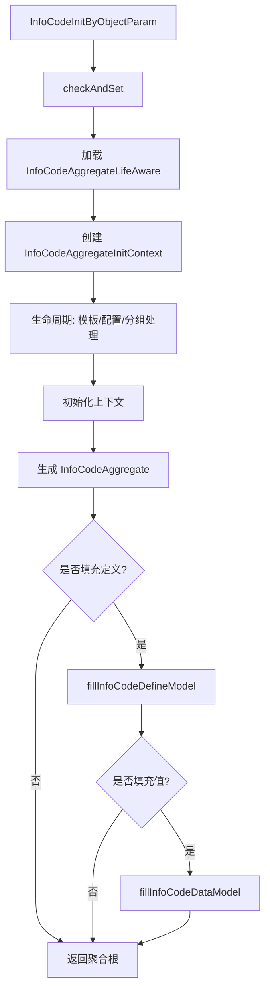

# 网关与生命周期

`InfoCodeGateway` 是信息点配置模块的领域网关。它把资源层配置、RWD 对象、生命周期处理器和解析策略组合起来，统一产出 `InfoCodeAggregate`。

## 网关职责

`InfoCodeGateway` 位于：

```text
common/src/main/java/com/persagy/apccontrol/basic/structure/infocodeconfig/gateway/InfoCodeGateway.java
```

主要职责：

| 方法 | 说明 |
| --- | --- |
| `of` | 根据对象和模板参数生成聚合根。 |
| `ofOrigin` | 生成原始配置聚合根，主要用于配置查看。 |
| `listTemplateTypes` | 查询模板类型。 |
| `listTemplateTypesWithObjects` | 查询模板类型并携带关联对象。 |
| `listTemplateTypeObjects` | 查询模板类型关联的 RWD 对象。 |
| `mapTemplateTypeAndObjectCount` | 查询模板类型和对象数量映射。 |
| `fillInfoCodeTemplateTypeModel` | 补充模板类型模型信息。 |
| `fillInfoCodeDefineModel` | 填充信息点定义模型。 |
| `fillInfoCodeDataModel` | 填充信息点值模型。 |
| `filterControlObjects` | 过滤管控对象。 |

## 聚合根创建流程

`InfoCodeGatewayImpl#of` 是聚合根创建入口。总体流程如下：



`InfoCodeAggregateInitContext` 负责持有初始化过程中的模板类型、信息点配置、分组配置、对象集合和中间映射。生命周期处理器可以在上下文初始化前后修改或补充这些数据。

## 生命周期接口

生命周期接口为 `InfoCodeAggregateLifeAware`，位于：

```text
common/src/main/java/com/persagy/apccontrol/basic/structure/infocodeconfig/lifecycle/InfoCodeAggregateLifeAware.java
```

执行顺序：

| 顺序 | 方法 | 阶段 |
| --- | --- | --- |
| 1 | `handleTemplateTypes` | 处理模板类型。 |
| 2 | `handleInfoCodeConfigs` | 处理信息点配置。 |
| 3 | `handleInfoCodeGroups` | 处理信息点分组配置。 |
| 4 | `beforeContextInit` | 上下文初始化前。 |
| 5 | `handleDatabaseData` | 数据库数据处理。 |
| 6 | `afterContextInit` | 上下文初始化后。 |
| 7 | `afterAggregateInit` | 聚合根初始化后。 |
| 8 | `beforeFillInfoCodeDefineModel` | 填充定义模型前。 |
| 9 | `afterFillInfoCodeDefineModel` | 填充定义模型后。 |
| 10 | `beforeFillInfoCodeDataModel` | 填充值模型前。 |
| 11 | `afterFillInfoCodeDataModel` | 填充值模型后。 |

生命周期实现类需要实现 `Ordered`。数值越小，优先级越高。

## 定义填充流程

`fillInfoCodeDefineModel` 会先执行定义填充前的生命周期，再按 `InfoCodeTypeEnum` 对聚合根分组，并调用对应策略的 `fillInfoCodeDefineModel`。完成后再执行定义填充后的生命周期。

```text
aggregates
  -> beforeFillInfoCodeDefineModel
  -> group by InfoCodeTypeEnum
  -> InfoCodeAnalyzeStrategy.fillInfoCodeDefineModel
  -> afterFillInfoCodeDefineModel
```

## 值填充流程

`fillInfoCodeDataModel` 会先组装附加数据，再按信息点类型并发调用策略。附加数据包括请求传入的时间范围、placeholder，以及网关预查询的 IOT、知识、风险事件等上下文。

```text
aggregates + additionalDataValues
  -> beforeFillInfoCodeDataModel
  -> mapAdditionalDataValues
  -> group by InfoCodeTypeEnum
  -> BusinessThreadPoolExecutor.ttlExecutor 并发执行策略
  -> afterFillInfoCodeDataModel
```

## 生命周期实现建议

- 默认使用 Spring 单例 Bean，处理逻辑应保持无状态。
- 只有需要在多个生命周期方法之间共享同一次请求的临时状态时，才考虑 prototype。
- 不要在单例生命周期处理器中使用实例字段保存请求级数据，避免并发污染。
- 生命周期处理器适合做横切增强、配置修正、批量预处理，不适合替代具体信息点类型的取值策略。
