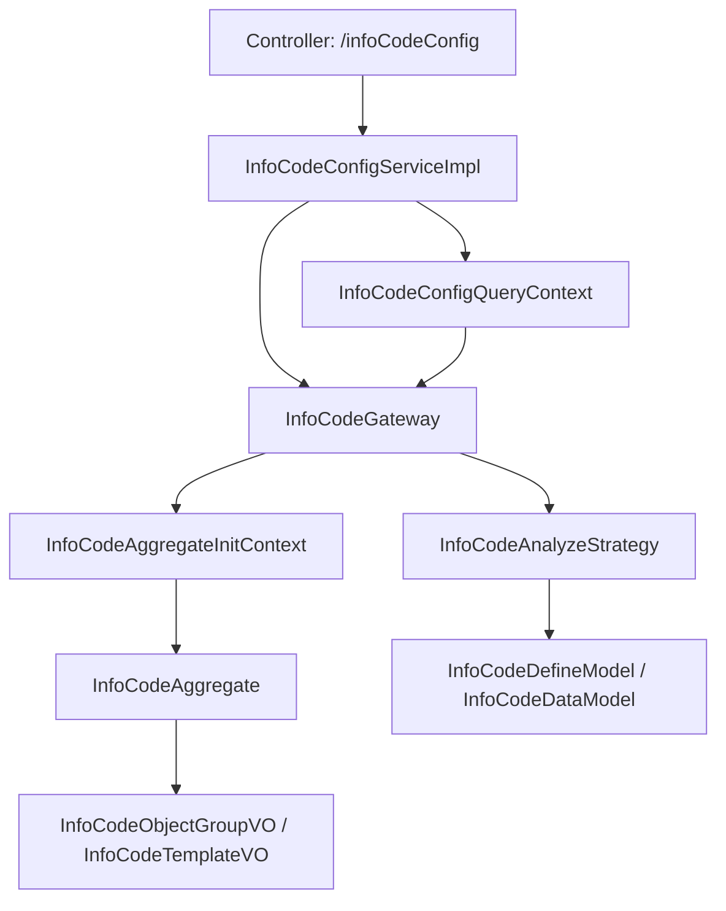

# 模块总览

信息点配置模块面向运行监控场景，为设备、空间等 RWD 对象查询可展示的信息点。它不是单纯的配置表查询，而是把模板、对象、信息点、分组、定义和值按统一模型聚合，再输出给前端。

## 模块职责

- 查询信息点模板类型，并按运行监控类型、二级类型、对象类型、模板类型、classCode 等条件过滤。
- 查询模板类型关联的 RWD 对象，并支持管控对象过滤、动态信息点过滤、对象数量统计。
- 根据模板、对象、信息点配置和分组配置生成 `InfoCodeAggregate` 聚合根。
- 按信息点类型填充定义模型 `InfoCodeDefineModel`。
- 按信息点类型填充值模型 `InfoCodeDataModel`。
- 将聚合根转换为 `InfoCodeTemplateVO`、`InfoCodeObjectGroupVO`、`InfoCodeConfigOriginVO`、`InfoCodeTemplateTreeVO` 等返回结构。

## 模块边界

| 边界 | 说明 |
| --- | --- |
| API 边界 | 新接口统一挂在 `/infoCodeConfig`，旧接口保留在 `/equipment/infoCodeConfig`。 |
| 编排边界 | `InfoCodeConfigServiceImpl` 负责接口级流程编排，不直接承载各类型信息点取值细节。 |
| 领域边界 | `InfoCodeGateway` 负责聚合根创建、定义填充、值填充和模板/对象查询复用能力。 |
| 策略边界 | `InfoCodeAnalyzeStrategy` 按 `InfoCodeTypeEnum` 拆分不同类型信息点的定义和值解析。 |
| 数据边界 | 配置数据来自信息点配置资源层，业务对象来自 RWD，实时/历史值来自 IOT 数据能力，附加数据来自知识、风险事件等上下文。 |

## 核心包结构

```text
common/src/main/java/com/persagy/apccontrol/basic
├── controller/infocodeconfig
│   ├── InfoCodeConfigController.java
│   └── OldInfoCodeConfigController.java
├── service/infocodeconfig
│   ├── InfoCodeConfigService.java
│   └── impl/InfoCodeConfigServiceImpl.java
├── model/context/infocodeconfig
│   └── InfoCodeConfigQueryContext.java
├── resource/infocodeconfig
│   ├── InfoCodeTemplateTypeResource.java
│   ├── InfoCodeConfigResource.java
│   └── InfoCodeGroupResource.java
└── structure/infocodeconfig
    ├── gateway
    ├── context
    ├── model
    ├── lifecycle
    ├── strategy
    ├── enumeration
    └── converter
```

## 总体调用链



## 主要查询模式

| 模式 | 入口 | 结果特点 |
| --- | --- | --- |
| 模板列表 | `listTemplateTypes` | 返回模板类型和对象数量，可按参数选择是否查询对象数量。 |
| 按模板查询配置 | `listInfoCodeConfigsByTemplateType` | 先根据模板找到对象，再生成对象维度的信息点分组。 |
| 按对象查询配置 | `listInfoCodeConfigsByObject` | 先查对象，再按对象和模板配置生成分组并填充值。 |
| 原始配置查询 | `listOriginInfoCodeConfigs` | 面向配置查看，返回模板下的原始信息点分组配置。 |
| 模板树 | `treeTemplateType` | 按建筑、楼层、空间组织模板关联对象统计。 |

## 设计取向

信息点配置的核心设计取向是“配置驱动 + 类型策略 + 聚合输出”。模板、分组和信息点配置提供静态骨架；RWD 对象决定作用范围；`InfoCodeTypeEnum` 和策略实现决定每类信息点如何得到定义和值；最终统一收敛到 `InfoCodeAggregate`，再转换为前端视图模型。
