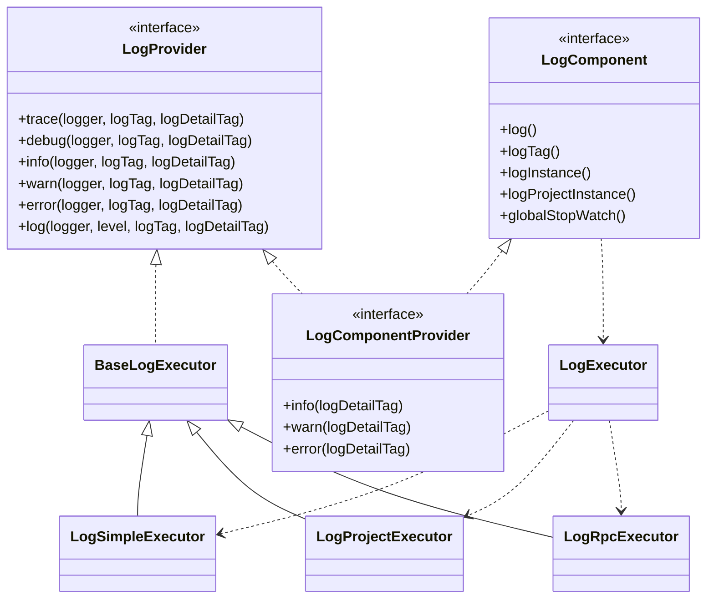
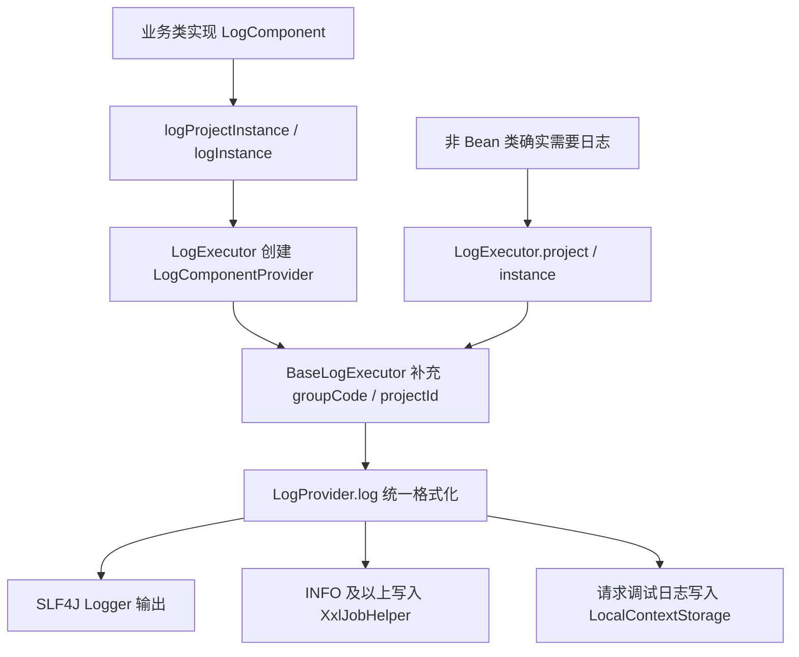

# 模块总览

日志模块提供项目内部统一的代码日志能力。它负责组装日志标签、日志详情、上下文参数、异常信息、XXL-JOB 输出和请求调试缓存，不负责运行日志查询、分类、导出或页面展示。

运行日志是业务数据模块，设计见 [运行日志](../running-log/README.md)。本文档描述的是 Java 代码中如何记录框架日志、业务过程日志和异常日志。

## 模块职责

- 提供统一日志输出接口 `LogProvider`。
- 通过 `LogComponent` 为业务对象提供简化调用入口。
- 通过 `LogExecutor` 创建普通、集团、项目、RPC 和 ProjectDTO 上下文执行器。
- 自动补充 `groupCode`、`projectId`、`projectLocalId`、`projectLocalName` 等上下文。
- 统一处理 `BusinessException`、`ApplicationException`、`FeignException` 和普通异常。
- 将 INFO 及以上日志同步写入 XXL-JOB 日志。
- 在请求调试模式下将日志写入 `LocalContextStorage`。
- 为非 Bean 的普通实体类保留不侵入序列化结构的日志兼容入口。

## 模块边界

| 边界 | 说明 |
| --- | --- |
| 代码日志 | `common/.../executor/log` 下的统一日志接口和执行器。 |
| 业务运行日志 | `RunningLog`、`RcRunningLog` 等业务日志查询和展示，不在本文档维护。 |
| 新代码入口 | 除非 Bean 的普通实体类外，使用 `LogProvider` 能力，通常通过 `LogComponent` 获取。 |
| 实体类例外 | 非 Bean 类不实现日志接口；确实需要日志时使用 `LogExecutor`。 |
| 历史代码 | 仓库内存在较多历史 `LogExecutor.*` 直接调用，后续迭代不按这些写法扩散。 |
| 原生日志 | 新增业务代码不直接使用 `@Slf4j` 或 `Logger` 输出格式化日志。 |

## 核心关系

## 总体链路

## 当前主干设计

当前主干是“组件对象提供日志标签，`LogProvider` 统一输出，执行器补充上下文”。业务对象通过实现 `LogComponent` 暴露 `logTag()`，再调用 `logProjectInstance()` 或 `logInstance()` 获取 `LogComponentProvider`。`LogComponentProvider` 同时继承 `LogComponent` 和 `LogProvider`，因此调用方只需要传日志详情、异常和附加字段。

非 Bean 的普通实体类不走这条链路。这类对象通常会被 Jackson、Redis、MyBatis 或消息框架序列化和反序列化，给它们挂载 `LogProvider`、`LogComponent` 或 `LogComponentProvider` 会带来额外方法、运行时状态或反射识别问题。后续非 Bean 类如需日志，只允许通过 `LogExecutor` 以静态方式输出。
