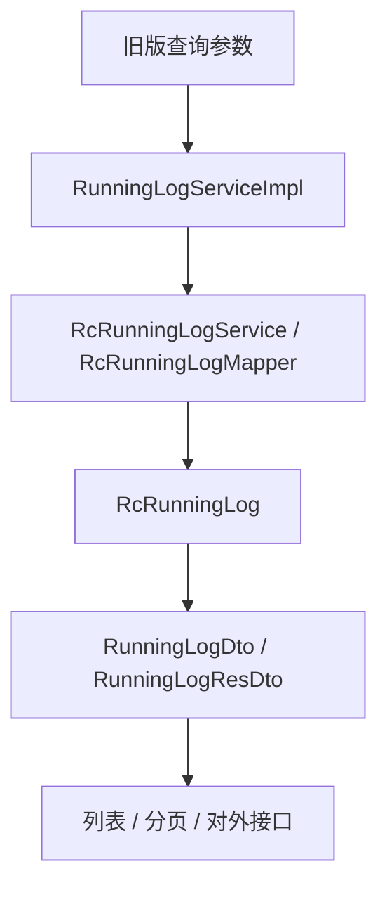
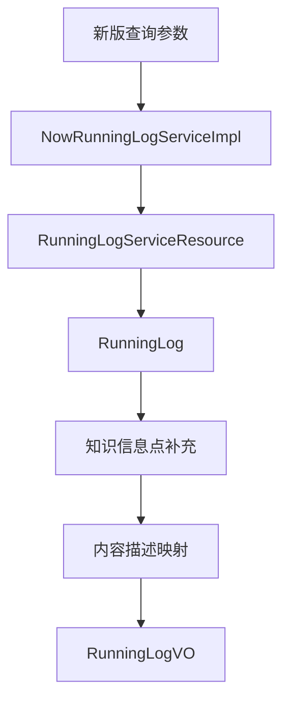

# 接口与查询流程

运行日志对外入口集中在 `RcRunningLogController`，基础路径为 `/runningLog`。该 Controller 同时承接旧版日志接口和新版日志接口。

## 接口清单

| 接口 | 方法 | 主要职责 | 服务 |
| --- | --- | --- | --- |
| `/queryRunningLogType` | GET | 查询运行日志类型枚举。 | `RunningLogTypeEnum` |
| `/listRunningLogByDate` | POST | 按日期查询旧版日志列表。 | `RunningLogService#listRunningLogByDate` |
| `/queryListByPage` | POST | 分页查询旧版日志。 | `RunningLogService#queryLogList` |
| `/listSecondLevelCategory` | POST | 查询一级分类下所有二级分类。 | `RunningLogService#listSecondLevelCategory` |
| `/equipmentList` | POST | 查询日志筛选用设备列表。 | `RunningLogService#equipmentList` |
| `/queryListByParam` | POST | 对外接口查询旧版日志列表。 | `RunningLogService#queryLogListByParam` |
| `/export` | POST | 旧版日志导出。 | `RunningLogService#export` |
| `/todayLogSummary` | POST | 查询值班首页运行播报统计。 | `PageBroadcastMsgQueryService#todayLogSummary` |
| `/listPageBroadcastMsg` | POST | 查询页面播报日志。 | `NowRunningLogService#listPageBroadcastMsg` |
| `/queryRunningLogListByPage` | POST | 分页查询新版运行日志。 | `NowRunningLogService#queryRunningLogListByPage` |
| `/downloadLog` | POST | 新版日志下载。 | `NowRunningLogService#downloadLog` |
| `/logCategoryList` | POST | 查询日志分类树。 | `RunningLogService#getLogCategoryList` |
| `/getSecondLevelRunningLogCategory` | POST | 查询数据库中存在的二级运行日志分类。 | `NowRunningLogService#getSecondLevelRunningLogCategory` |

## 旧版日志查询

旧版日志围绕 `RcRunningLog`：

`listRunningLogByDate` 和 `queryLogList` 都会查询 `RcRunningLog`，再通过 `RunningLogService#getRunningLogDtos` 转成旧版 DTO。`queryListByParam` 面向对外接口，返回 `RunningLogResDto`。

## 新版日志查询

新版日志围绕 `RunningLog`：

`queryRunningLogListByPage` 通过 `RunningLogServiceResource#queryRunningLogListByPage` 分页查询 `RunningLog`，再调用 `mappingRunningLogVO` 补充知识信息点、内容描述、分类文案和展示字段。

## 设备列表查询

`RunningLogService#equipmentList` 会先设置当前项目 ID。若参数中包含新版一级分类，则进入 `adaptiveNowEquipmentList`，从新版日志查询数据并适配设备列表；否则走 `RcRunningLogMapper#equipmentList` 查询旧版设备列表。

设备列表是日志筛选能力的一部分，不代表运行日志模块维护设备本身。

## 导出与下载

旧版 `/export`：

- 将分页参数调整为第一页、较大页大小。
- 查询 `RcRunningLog`。
- 使用 EasyPOI 导出为 Excel。
- 通过 `DownFileService#handlerDownLoadByWorkbook` 生成下载 key。

新版 `/downloadLog`：

- 查询新版 `RunningLog`。
- 映射为下载 VO。
- 使用 EasyPOI 导出并生成下载 key。

## 页面播报和今日汇总

`/listPageBroadcastMsg` 使用 `NowRunningLogService#listPageBroadcastMsg` 查询页面播报日志，并映射为 `RunningLogVO`。

`/todayLogSummary` 当前 Controller 委托 `PageBroadcastMsgQueryService#todayLogSummary`，新版 Service 中也提供 `NowRunningLogService#todayLogSummary`，用于按当日类型统计和获取最新自动日志内容。

## 维护要点

- 新增查询条件时要区分旧版参数和新版参数。
- 新增展示字段时要同时检查列表、导出、下载和播报映射。
- 分页查询、对外查询和导出使用的返回 DTO 不同，不要只改其中一处。
- 设备列表既可能来自旧版 mapper，也可能由新版日志适配，分类参数会影响查询路径。
