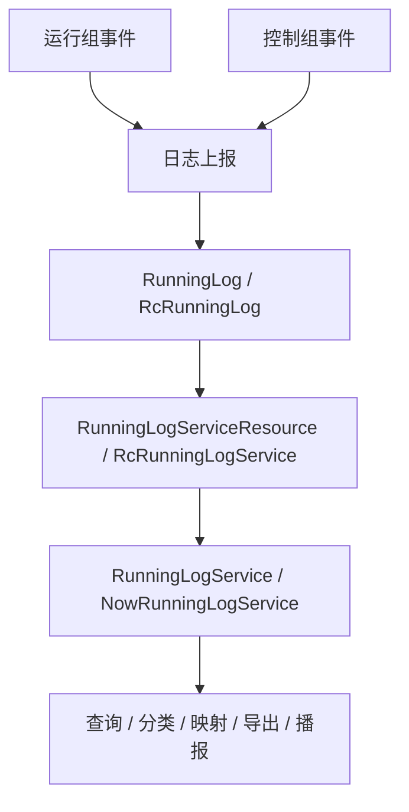

# 数据来源与上报边界

运行日志模块维护日志消费侧能力，日志数据可以由运行组和控制组共同上报。运行组负责日志表、查询接口、分类映射、展示 VO、导出下载和页面播报；控制动作本身和控制结果判定仍归控制组。

## 数据来源

| 来源 | 说明 |
| --- | --- |
| 运行组上报 | 运行监测、策略、运行状态等运行侧事件。 |
| 控制组上报 | 控制动作、指令结果、手自动、强控等控制侧事件。 |
| 系统内部日志 | 通过 `RunningLogAddService#saveByMeosMsg` 保存 MEOS 内部日志。 |
| 外部/资源层查询 | 通过资源层读取 `running_log` 和 `rc_running_log`。 |

控制组上报日志后，运行组需要确保分类、对象、文案、筛选和展示能承接，但不维护控制动作执行逻辑。

## 资源层

| 资源层 | 主要职责 |
| --- | --- |
| `RunningLogServiceResource` | 新版 `RunningLog` 数据库操作。 |
| `RcRunningLogService` | 旧版 `RcRunningLog` 数据库操作。 |
| `RunningLogServiceResourceImpl` | 新版资源层实现。 |
| `RcRunningLogServiceImpl` | 旧版资源层实现。 |

`RunningLogServiceResource` 提供以下关键能力：

- `getIdByUnknown`：按 `traceId`、`objectId`、`infoCode` 查询状态未知日志 ID。
- `updateStateById`：按 ID 更新日志来源状态。
- `listPageBroadcastMsg`：查询页面播报日志。
- `queryRunningLogListByPage`：分页查询新版日志。
- `createPartitionAndDeleteHistoryPartition`：创建分区并删除历史分区。
- `countWithTypeByToday`：统计项目当日日志类型数量。
- `getSecondLevelRunningLogCategory`：查询有数据的二级分类。

## Mapper 与表

| 表/实体 | Mapper | XML |
| --- | --- | --- |
| `running_log` / `RunningLog` | `RunningLogMapper` | `common/src/main/resources/mapper/RunningLogMapper.xml` |
| `rc_running_log` / `RcRunningLog` | `RcRunningLogMapper` | `common/src/main/resources/mapper/RcRunningLogMapper.xml` |

新增查询字段、筛选条件或排序规则时，需要同步 Java 参数、Mapper 接口和 XML。

## 状态更新

新版日志包含 `RunningLogSourceStateEnum state`，用于表示来源状态。控制组或其他上报方如果先写入未知状态，后续可以通过 `getIdByUnknown` 定位日志，再通过 `updateStateById` 更新结果。

状态更新只描述日志记录状态，不代表运行组维护控制动作状态机。

## 数据流

## 维护要点

- 上报来源新增字段时，要确认旧版和新版日志实体是否都需要承接。
- 控制组新增上报类型时，运行组负责分类和展示承接，不负责控制动作执行。
- 新版日志状态更新要保证 `traceId`、`objectId`、`infoCode` 能定位到待更新日志。
- 分区和历史分区清理属于新版日志资源层能力，调整时要关注项目维度。
