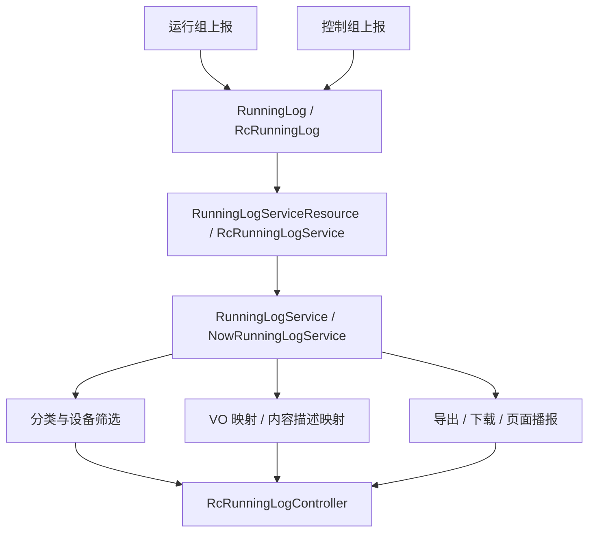

# 模块总览

运行日志模块面向运行监测、控制动作、值班首页和外部查询提供统一的日志消费能力。它承接运行组和控制组上报的数据，并在运行组侧完成日志查询、分类映射、设备筛选、导出下载、页面播报和今日汇总。

## 模块职责

- 查询旧版 `RcRunningLog` 和新版 `RunningLog` 日志列表。
- 提供日志类型、一级分类、二级分类和设备筛选数据。
- 将日志实体映射为页面展示 VO、导出 VO 和首页播报内容。
- 支持旧版日志导出和新版日志下载。
- 支持值班首页今日日志汇总和页面播报。
- 维护日志分类对象查询策略，按日志分类定位关联系统或设备对象。
- 承接运行组和控制组上报的日志数据，但不接管控制动作本身。

## 模块边界

| 边界 | 说明 |
| --- | --- |
| 查询展示边界 | `RcRunningLogController` 对外提供 `/runningLog` 相关查询接口。 |
| 旧版日志边界 | `RunningLogService` 处理 `RcRunningLog` 查询、分页、设备列表和导出。 |
| 新版日志边界 | `NowRunningLogService` 处理 `RunningLog` 查询、下载、播报、今日汇总和 VO 映射。 |
| 分类边界 | `runninglog/category` 负责分类构建和分类对象查询策略。 |
| 上报边界 | 运行组和控制组都可以上报日志，运行组维护日志消费侧结构。 |
| 控制边界 | 控制动作、指令下发、手自动、强控和干预结果归控制组。 |
| 策略边界 | 运行日志不属于 `RunningMonitorStrategy`，策略层不查询和写入日志。 |

## 核心包结构

```text
common/src/main/java/com/persagy/apccontrol/basic
├── controller/RcRunningLogController.java
├── service
│   ├── runninglog
│   │   ├── RunningLogService.java
│   │   ├── RunningLogServiceImpl.java
│   │   ├── NowRunningLogService.java
│   │   ├── NowRunningLogServiceImpl.java
│   │   ├── RunningLogTemplateConfig.java
│   │   └── category
│   └── common/PageBroadcastMsgQueryService.java
├── resource
│   ├── RunningLogServiceResource.java
│   ├── RcRunningLogService.java
│   └── param/runningLog
├── model
│   ├── entity/RunningLog.java
│   ├── entity/RcRunningLog.java
│   ├── enumtype/runningLog
│   ├── dto/runnningLog
│   └── vo/log
└── mapper
```

## 总体关系



## 主干设计

运行日志当前同时保留旧版和新版两套模型。旧版以 `RcRunningLog` 为核心，主要服务历史日志查询和旧版导出；新版以 `RunningLog` 为核心，支持页面播报、今日汇总、状态更新、二级分类查询和更丰富的内容映射。

运行组维护的是日志消费链路：从表和资源层查询日志，按分类、对象、时间、类型等条件过滤，再映射为前端需要的 DTO/VO。日志产生方可以来自运行组或控制组，控制组上报的控制动作日志不会改变控制能力的维护归属。
