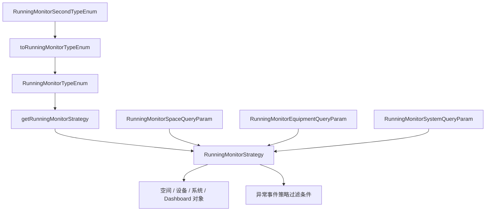

# 模块总览

当前运行组维护的运行监测能力，以 `RunningMonitorStrategy` 策略体系为中心。策略负责把“运行监测一级类型/二级类型 + 查询参数”转换为 RWD 空间、设备、系统和 Dashboard 对象集合，并提供策略级异常事件过滤条件。

历史上运行监测目录下还沉淀了通用 `/running-monitor` 接口、2D 系统图运行态、边缘控制、手自动、强控等链路。这些代码现在不再作为运行组维护入口，后续迭代不会基于它们继续扩展，会按实际情况迁移或删除。运行日志已经拆成独立设计模块，见 [运行日志程序设计文档](../running-log/README.md)。

## 模块职责

- 按运行监测类型和二级类型查询空间、设备、系统和 Dashboard 对象。
- 通过一级类型和二级类型完成策略分派。
- 复用公共查询参数中的对象、类别、建筑、楼层、字段、信息点规则和值过滤能力。
- 为 Dashboard 空间和系统查询提供按业务类型拆分的策略实现。
- 为异常事件能力提供策略级风险目标和对象过滤扩展点。
- 通过基础策略兼容少量旧实例参数，但新逻辑应使用 `RunningMonitorSpaceQueryParam`、`RunningMonitorEquipmentQueryParam` 和 `RunningMonitorSystemQueryParam`。

## 模块边界

| 边界 | 说明 |
| --- | --- |
| 当前维护边界 | `RunningMonitorStrategy`、策略实现、运行监测类型枚举、二级类型枚举和策略查询参数。 |
| 查询对象边界 | 策略只返回 RWD 对象 DTO/VO，不负责组装页面信息点树、运行日志或控制状态。 |
| 参数边界 | 新逻辑使用 `RunningMonitorSpaceQueryParam`、`RunningMonitorEquipmentQueryParam`、`RunningMonitorSystemQueryParam`。 |
| 日志边界 | 运行日志由运行组维护，但作为独立模块设计，不放在运行监测策略文档中展开。 |
| 兼容边界 | `BaseRunningMonitorStrategy` 仍兼容旧 `DemandInstanceValueObject` 入参，但只用于过渡。 |
| 非维护边界 | 旧 Controller、旧 Service、`AbstractRunningMonitorServer`、边缘控制链路不再作为运行组设计目标。 |
| 控制组边界 | 参数设定、手自动、强控、干预解除、累计运行时间清除等控制能力归控制组。 |

## 核心包结构

```text
common/src/main/java/com/persagy/apccontrol/basic
├── structure/common/strategy
│   ├── RunningMonitorStrategy.java
│   ├── BaseRunningMonitorStrategy.java
│   ├── StaticRunningMonitorStrategy.java
│   └── impl
├── model
│   ├── enumtype/RunningMonitorTypeEnum.java
│   ├── enumtype/RunningMonitorSecondTypeEnum.java
│   └── param/common
│       ├── BaseObjectQueryParam.java
│       ├── RunningMonitorSpaceQueryParam.java
│       ├── RunningMonitorEquipmentQueryParam.java
│       └── RunningMonitorSystemQueryParam.java
└── outside/vo/riskevent
```

## 总体关系



## 主干设计

运行监测当前主干是“枚举分派策略，策略返回对象集合”。二级类型先转换为一级类型，一级类型再通过 `strategyBeanName` 获取策略 Bean；如果没有专用策略，则回退到 `StaticRunningMonitorStrategy`。

策略实现只关心对象范围、Dashboard 查询和异常事件过滤，不承接控制动作、运行日志、2D 系统图运行态组装和信息点详情树。后续设计评审时，如果需求落在日志能力，应进入运行日志设计文档；如果需求落在控制链路，应先确认是否属于控制组或历史迁移/删除工作。
