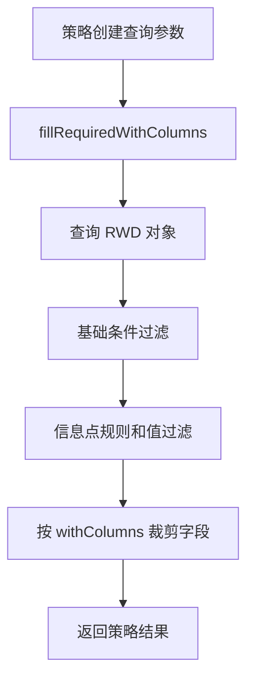

# 策略查询契约

运行监测策略的新查询入口围绕三个参数对象展开：空间、设备和系统。它们继承公共对象查询参数，提供运行监测二级类型、对象过滤、类别过滤、建筑楼层过滤、字段裁剪、信息点规则过滤、信息点值过滤和缓存 key 能力。

## 查询参数类型

| 参数 | 继承 | 用途 |
| --- | --- | --- |
| `RunningMonitorSpaceQueryParam` | `SpaceQueryParam` | 查询运行监测空间和 Dashboard 空间。 |
| `RunningMonitorEquipmentQueryParam` | `EquipmentQueryParam` | 查询运行监测设备。 |
| `RunningMonitorSystemQueryParam` | `SystemQueryParam` | 查询 Dashboard 或模块需要的系统对象。 |

三个参数都支持 `runningMonitorSecondType` 和 `runningMonitorSecondTypes`。调用 `getRunningMonitorSecondTypes` 时，如果显式集合非空，优先使用集合；否则把单个二级类型包装为集合；二者都为空时返回空。

## 二级类型契约

`runningMonitorSecondType` 和 `runningMonitorSecondTypes` 是策略分支的重要依据。策略内需要关注：

- 单二级类型和多二级类型都应能表达同一类查询条件。
- 当策略只支持单类型时，应明确校验或只取当前业务认可的类型。
- 需要从二级类型归并到一级类型时，使用 `RunningMonitorSecondTypeEnum#toRunningMonitorTypeEnum`。
- 与需求配置联动时，使用 `RunningMonitorSecondTypeEnum#toDemandTemplateTypeEnum`。

## 公共过滤字段

`BaseObjectQueryParam` 提供以下公共过滤能力：

| 字段 | 说明 |
| --- | --- |
| `filterObjectIds` | 限定对象 ID。 |
| `filterClassCodes` | 限定对象类别。 |
| `filterExcludeClassCodes` | 排除对象类别。 |
| `filterBuildingIds` | 限定所在建筑。 |
| `filterFloorIds` | 限定所在楼层。 |
| `withColumns` | 控制返回字段，减少 RWD 查询和响应体积。 |
| `filterInfoCodeRules` | 只保留存在指定信息点规则的对象。 |
| `filterInfoCodeValueMap` | 只保留指定信息点值满足条件的对象。 |
| `excludeInfoCodeValues` | 排除指定信息点值满足条件的对象。 |

这些过滤会在 `queryObject` 中统一处理。策略实现应优先使用公共过滤能力，不要在每个策略里重复写对象 ID、类别、建筑、楼层和信息点规则过滤。

## 查询流程

`BaseObjectQueryParam#queryObject` 的通用流程：

1. `fillRequiredWithColumns` 根据过滤条件补齐必须查询字段。
2. 调用子类实现的 `queryObject(originalQueryParam, realQueryParam, customQuery)` 查询 RWD 对象。
3. `filterBasicCondition` 在内存中处理无法直接下推的基础过滤。
4. `filterInfoCodeCondition` 处理信息点规则和值过滤。
5. `DtpRwdObjectDTO.clearUselessFieldValueByWithColumns` 根据 `withColumns` 裁剪返回字段。

## 信息点规则和值过滤

`filterInfoCodeRules` 通过 `AbstractIotDataCacheServer#mapObjectIdAndExistsRuleInfoCodes` 判断对象是否存在指定信息点规则。

`filterInfoCodeValueMap` 和 `excludeInfoCodeValues` 通过 `listInfoCodeValueInOneHour` 查询近一小时信息点值，再按 `DynamicInfoCodeFilter` 判断保留或排除。

这两个能力是策略层的对象筛选条件，不是运行态信息点详情查询。策略不负责返回信息点分组树、实时值面板或控制点位状态。

## 缓存契约

公共参数提供 `mysqlCache` 和 `mysqlCacheKey` 能力。运行监测三个参数会把二级类型值拼入 `mysqlCacheKeyType`，避免不同二级类型复用同一个缓存结果。

缓存使用原则：

- 只有 `filterInfoCodeValueMap` 和 `excludeInfoCodeValues` 都为空时，`canCache` 才可能为 true。
- 需要实时值参与过滤的查询不应复用 MySQL 缓存。
- 新增二级类型或多二级类型查询时，要确认缓存 key 能区分业务范围。

## 维护要点

- 新策略应优先使用三个新查询参数，不要继续扩展废弃的 `DemandInstanceValueObject` 入参。
- 策略返回对象集合即可，不要在策略中组装运行态页面结构。
- 信息点规则和值过滤只用于筛对象，不用于替代信息点展示接口。
- `withColumns` 是接口性能和响应结构的契约，新增查询字段时要明确是否必须返回。
