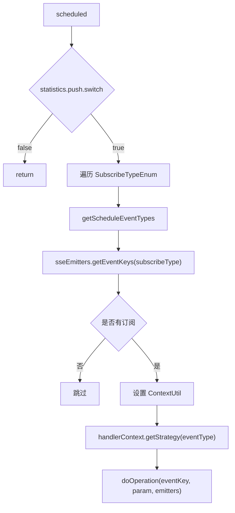

# 云边差异与调度

SSE 框架在公共层，调度任务分别落在云端计算服务和边缘计算服务。云端通常做周期性批量刷新，边缘端除了周期刷新，还会承接 MQTT/IOT 实时触发。

## 调度开关

云端和边缘端定时任务都读取：

```text
statistics.push.switch
```

默认值为 `true`。关闭后对应定时任务直接返回，但不影响事件触发式推送。

## 云端 5 分钟调度

类：

```text
saas/meos-control-compute/src/main/java/com/persagy/apccontrol/task/sse/SseEventScheduledService.java
```

cron：

```text
0 0/5 * * * *
```

主要事件：

| 订阅类型 | 事件 |
| --- | --- |
| `LIGHT_MONITORING` | `CLOUD_IOT_DATA_CHANGE`、`ILLUM_INFO`、`LIGHTING_LAMP_FUNC_TYPE_STATUS`、`ABNORMAL_STATE`、`LIGHTING_DASHBOARD_*` |
| `AIR_TERMINAL` | `SPACE_WITH_STATUS`、`SPACE_QUALITY_STATISTICS`、`EQUIPMENT_STATUS_STATISTICS`、`BDTP_EQUIPMENT_STATUS_STATISTICS`、`OUTDOOR_WEATHER`、`INFO_CODE_CONFIG_EVENT`、`CLOUD_IOT_DATA_CHANGE` |
| `SECURITY` | 安防统计、`CLOUD_IOT_DATA_CHANGE`、`SECURITY_DASH_BOARD`、`ABNORMAL_STATE` |
| `VENTILATION`、`ELEVATOR`、`PARKING` 等 | 以 `CLOUD_IOT_DATA_CHANGE` 和领域统计事件为主 |
| 冷源/冷热源/给排水/变配电等 | `CLOUD_IOT_DATA_CHANGE`、`INFO_CODE_CONFIG_EVENT` |

## 云端 15 分钟调度

类：

```text
saas/meos-control-compute/src/main/java/com/persagy/apccontrol/task/sse/SseEventScheduledServiceFor15Min.java
```

cron：

```text
0 0/15 * * * *
```

当前主要用于客流：

| 订阅类型 | 事件 |
| --- | --- |
| `PASSENGER_FLOW` | `PASSENGER_FLOW_HEAD_TOTAL` |

## 边缘 1 分钟调度

类：

```text
local/meos-control-compute-edge/src/main/java/com/persagy/apccontrol/task/scheduled/sse/SseEventScheduledLocalService.java
```

cron：

```text
0 0/1 * * * *
```

边缘 1 分钟调度更偏本地运行页面刷新：

| 订阅类型 | 事件 |
| --- | --- |
| `LIGHT_MONITORING` | `LIGHTING_LAMP_FUNC_TYPE_STATUS`、`ABNORMAL_STATE`、`LIGHTING_DASHBOARD_*` |
| `AIR_TERMINAL` | 空间质量、设备状态、天气、对象标签、信息点配置、空间状态 |
| `SECURITY` | 安防统计、Dashboard、异常状态 |
| `VENTILATION` | 通风统计、信息点配置 |
| `ELEVATOR`、`PASSENGER_FLOW`、`PARKING` | `EQUIPMENT_BUSINESS` 和领域统计事件 |
| 冷源/冷热源/消防/光伏/卫生间等 | `INFO_CODE_CONFIG_EVENT` |

## 边缘 15 分钟调度

类：

```text
local/meos-control-compute-edge/src/main/java/com/persagy/apccontrol/task/scheduled/sse/SseEventScheduledLocalServiceFor15Min.java
```

cron：

```text
0 0/15 * * * *
```

当前主要用于客流：

| 订阅类型 | 事件 |
| --- | --- |
| `PASSENGER_FLOW` | `PASSENGER_FLOW_HEAD_TOTAL`、`PASSENGER_FLOW_HOME_STATISTICS` |

## 调度执行流程



## 云边差异维护要点

- 云端调度常使用 `CLOUD_IOT_DATA_CHANGE` 做批量刷新。
- 边缘实时 IOT 变化使用 `IOT_DATA_CHANGE`，不依赖定时任务。
- 同一事件在云边可能有不同策略实现或不同触发频率，修改前要确认运行环境。
- 调度事件清单硬编码在对应 `getScheduleEventTypes` 中，新增订阅类型或事件要同步云边清单。
- 不要用 WebSocket 作为边缘实时刷新补充，实时变更应触发 SSE 策略。
