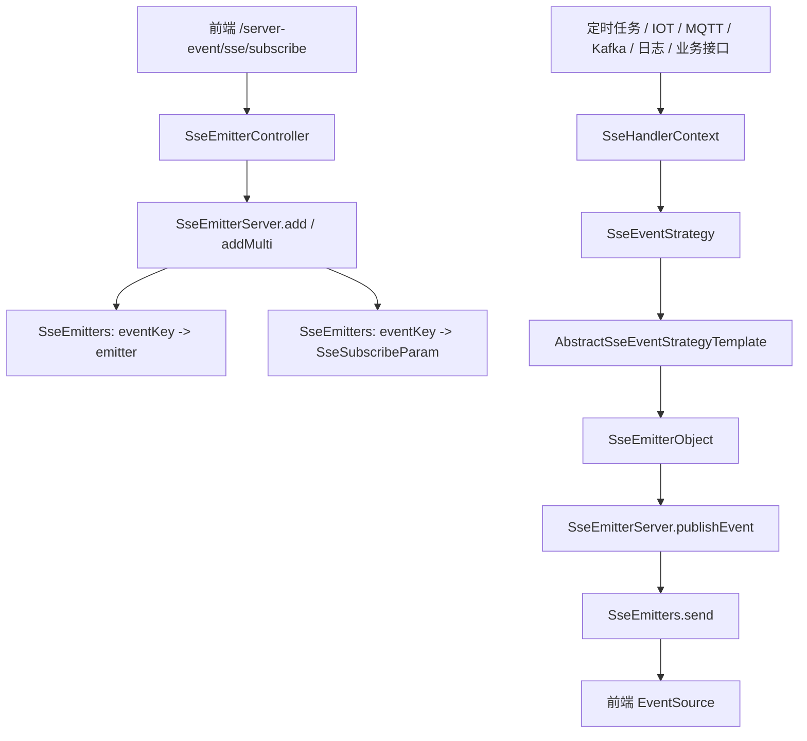

# 模块总览

SSE 推送模块是当前前端实时数据更新的主入口。它通过 HTTP `text/event-stream` 长连接保存订阅关系，再由业务事件、IOT 数据变化、Kafka/MQTT 消息、运行日志、定时任务等触发策略生成 `SseEmitterObject`，最终按 eventKey 推送给匹配的前端连接。

WebSocket 已废弃。历史 WebSocket 类中仍可能残留 IOT 推送、页面播报和信息点扩展转调，但后续新增能力应直接进入 SSE 订阅和策略体系。

## 模块职责

- 创建和维护 SSE 长连接。
- 保存 eventKey 与 `SseSubscribeParam` 的映射。
- 按项目、订阅类型、事件类型和对象范围筛选订阅者。
- 通过 `SseEmitterEventEnum` 分派到对应策略。
- 支持定时刷新、事件触发、条件触发和手动发布。
- 统一构造 `SseEmitterObject` 响应。
- 通过异步线程池执行事件计算和发送。
- 提供连接缓存、订阅参数和线程池队列观测能力。

## 模块边界

| 边界 | 说明 |
| --- | --- |
| 当前维护边界 | `SseEmitterController`、`SseEmitterServer`、`SseEmitters`、SSE 事件枚举、订阅类型、策略模板和策略实现。 |
| 云边边界 | 公共 SSE 框架在 `common`，云端和边缘端各自提供调度、触发源和部分策略。 |
| WebSocket 边界 | WebSocket 已废弃，只保留历史兼容；新增推送不再新增 `WSClient`、`IWSMessageService` 或 `websocket_config` 依赖。 |
| MQTT 边界 | MQTT 是边缘消息来源，SSE 是消费后的前端推送方式；MQTT 接入设计见 [边缘 MQTT](../edge-mqtt/README.md)。 |
| 运行日志边界 | 日志可触发 `PAGE_BROADCAST`，但日志查询、分类、导出由 [运行日志](../running-log/README.md) 维护。 |
| 控制组边界 | 控制动作本身不归 SSE 模块；SSE 只负责承接控制组或边缘服务上报后的页面通知。 |

## 总体链路



## 核心包结构

```text
common/src/main/java/com/persagy/apccontrol/basic
├── controller/SseEmitterController.java
├── sse
│   ├── CustomSseEmitter.java
│   ├── SseEmitterEventEnum.java
│   ├── SseEmitterObject.java
│   ├── SseEmitterServer.java
│   ├── SseEmitters.java
│   ├── SseSubscribeParam.java
│   ├── SubscribeTypeEnum.java
│   ├── annotation/SsePollingParam.java
│   └── strategy
│       ├── AbstractSseEventStrategyTemplate.java
│       ├── SseEventStrategy.java
│       ├── SseHandlerContext.java
│       └── ...
└── config/ExecutorConfig.java
```

```text
local/meos-control-compute-edge/src/main/java/com/persagy/apccontrol
├── controller/SseEmitterEdgeController.java
└── task/scheduled/sse
```

```text
saas/meos-control-compute/src/main/java/com/persagy/apccontrol
├── controller/SseEmitterSaasController.java
└── task/sse
```

## 当前主干设计

当前主干是“订阅参数决定连接范围，事件枚举决定策略，策略决定数据，连接缓存决定发送目标”。业务侧不直接给所有连接广播，而是调用对应 SSE 策略，由策略根据订阅参数过滤目标连接并组装数据。

后续设计评审时，如果需求是实时页面刷新，应优先确认：

- 前端需要订阅哪个 `SubscribeTypeEnum`。
- 事件应新增还是复用 `SseEmitterEventEnum`。
- 推送数据是否需要 `eventParamMap`。
- 是否需要按 classCode/objectId 过滤。
- 触发源是定时、IOT 变化、日志、业务消息还是手动接口。
