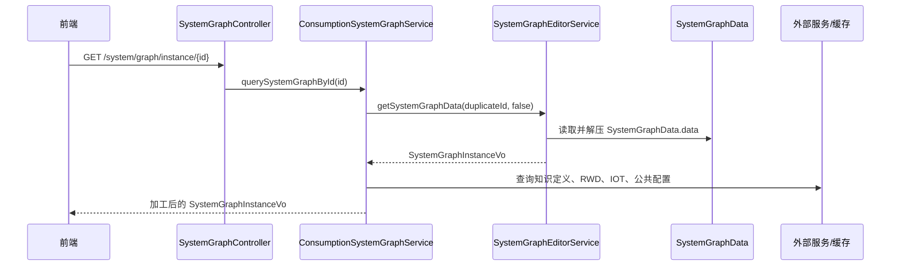

# 接口与查询流程

关系图接口分为展示查询、编辑器、Dashboard、外部接口、图例图标管理五类。展示查询和编辑器入口在 `common`，图例图标管理入口目前在 SaaS 服务。

## 展示查询接口

`SystemGraphController` 的基础路径为 `/system/graph`。

| 接口 | 用途 | 主要调用 |
| --- | --- | --- |
| `GET /icon/filter/config` | 图标滤镜参数 | `CommonConfigService#getSystemIconFilterConfig` |
| `GET /pipeline/style/config` | 管线样式配置 | `CommonConfigService#pipeLineStyleConfig` |
| `GET /area/style/config` | 区域样式配置 | `CommonConfigService#areaStyleConfigVos` |
| `GET /multiple/config` | 管道和文字多倍尺寸 | `CommonConfigService#multipleConfig` |
| `GET /relation/graph/{systemObjectId}` | 历史接口，当前默认返回空列表 | `ConsumptionSystemGraphService#getRelationGraphId` |
| `GET /instance/{id}` | 按 `system_graph.id` 查询运行态图纸 | `ConsumptionSystemGraphService#querySystemGraphById` |
| `GET /model/{id}` | 查询联动模型数据 | `ConsumptionSystemGraphService#modelInstanceList` |
| `GET /has/{systemId}` | 查询系统实例是否有系统图 | `ConsumptionSystemGraphService#getGraphType` |
| `GET /menu/config` | 查询菜单配置树 | `ConsumptionSystemGraphService#getMenuConfig` |
| `GET /graph/config` | 关系图配置 | `CommonConfigService#getGraphConfig` |
| `GET /graph/info/config` | 关系图信息点展示配置 | `CommonConfigService#getGraphInformation` |
| `GET /diagram/icon/config` | 图标更换配置 | `CommonConfigService#getDiagramIconChangeConfig` |
| `GET /interactive/config` | 交互配置 | `CommonConfigService#getInteractiveConfig` |
| `GET /instance/select` | 按对象、类编码、图类型查询发布入口 | `SystemGraphService#getSystemGraph` |
| `GET /instance/list/select` | 按对象和类编码查询图列表 | `SystemGraphService#listSystemGraph` |
| `GET /primitives/config` | 模型图图元 | `CommonConfigService#getModelDiagramPrimitives` |
| `GET /system/run/config` | 系统运行参数 | `CommonConfigService#getSystemRunParam` |
| `GET /exception/event/config` | 异常事件配置 | `CommonConfigService#getExceptionEventConfig` |
| `GET /orderFailAlarm/config` | 控反不一致配置 | `CommonConfigService#getOrderFailAlarm` |

`/relation/graph/{systemObjectId}` 是历史接口，当前实现中默认列表组装逻辑被注释，方法返回空列表。后续不应把它作为新增关系图查询入口；如需处理该接口，应先确认调用方是否仍存在，再决定兼容、迁移或删除。

## 编辑器接口

`SystemGraphEditorController` 的基础路径为 `/systemGraphEditor`。

| 接口 | 用途 | 主要调用 |
| --- | --- | --- |
| `GET /listSystemTemplate` | 获取系统模板列表 | `SystemGraphEditorService#listSystemTemplate` |
| `POST /initSystemGraph` | 初始化图纸 | `SystemGraphEditorService#initSystemGraph` |
| `POST /listSystemGraphDuplicate` | 获取副本列表，存在异步任务时先补生成 | `SystemGraphEditorService#listSystemGraphDuplicate` |
| `POST /createSystemGraphDuplicate/{duplicateId}` | 创建副本 | `SystemGraphEditorService#createSystemGraphDuplicate` |
| `POST /recalculatePipeline/{duplicateId}` | 重新计算管线 | `SystemGraphEditorService#recalculatePipeline` |
| `GET /getSystemGraphData/{duplicateId}` | 获取图纸数据和细节调整 | `SystemGraphEditorService#getSystemGraphData` |
| `POST /editSystemGraph/{duplicateId}` | 更新图纸主体数据 | `SystemGraphEditorService#editSystemGraph` |
| `POST /publishSystemGraph/{duplicateId}` | 发布图纸 | `SystemGraphEditorService#publishSystemGraph` |
| `POST /deleteSystemGraphDuplicate/{duplicateId}` | 删除未发布副本 | `SystemGraphEditorService#deleteSystemGraphCopy` |
| `POST /offlineSystemGraph/{duplicateId}` | 下架已发布图纸 | `SystemGraphEditorService#offlineSystemGraph` |
| `POST /saveAndUpdateSystemGraphDetail` | 保存或更新单条细节调整 | `SystemGraphEditorService#saveAndUpdateSystemGraphDetail` |
| `POST /saveAndUpdateSystemGraphDetailBatch` | 批量保存或更新细节调整 | `SystemGraphEditorService#saveAndUpdateSystemGraphDetailBatch` |
| `POST /deleteSystemGraphDetail` | 删除细节调整 | `SystemGraphEditorService#deleteSystemGraphDetail` |
| `POST /getSystemGraphDetailById` | 查询细节调整 | `SystemGraphEditorService#getSystemGraphDetailById` |
| `POST /listInfoCode` | 查询图中设备已绑定的信息点全集 | `SystemGraphEditorService#listInfoCode` |
| `POST /editDuplicateName` | 更新副本名称 | `SystemGraphEditorService#editDuplicateName` |
| `POST /updateTemplateName` | 更新模板别名 | `SystemGraphEditorService#updateTemplateName` |
| `POST /copyDetailData` | 复制细节数据 | `SystemGraphEditorService#copyDetailData` |

## Dashboard 和外部接口

| Controller | 接口 | 用途 |
| --- | --- | --- |
| `DashboardSystemGraphController` | `POST /dashboard/systemGraph/listSystemByFirstMenuCode/{menuCode}` | 根据一级菜单查询系统卡片，并标识是否存在已发布关系图。 |
| `SystemGraphExternalController` | `POST /external/systemGraph/querySystemGraphList` | 外部系统按类编码查询已发布关系图列表。 |

Dashboard 查询会先通过菜单配置和图配置反推图类型和系统类编码，再查询 `system_graph`，批量加载副本图纸数据，最后给 `SystemCardVO` 填充 `isExistsSystemGraph`、`graphTypeCode` 和图内对象集合。

外部查询会按 `projectId`、`classCode` 和 `systemGraphDuplicateId is not null` 过滤 `system_graph`，并结合菜单配置、图配置输出菜单编码、系统名、源类编码和是否项目级图。

## 图例图标管理接口

SaaS 图例入口 `GraphLegendController` 的基础路径为 `/graph/legend`。

| 接口 | 用途 |
| --- | --- |
| `GET /type/tree` | 查询设备类树，并标记需要更新图例的类。 |
| `GET /query/{classCode}` | 查询某类编码下的图例和图标列表。 |
| `GET /query/guest/{classCode}` | 对外查询图例，返回可访问文件 URL。 |
| `GET /query/all` | 查询全部图例。 |
| `GET /initPicUrl` | 根据文件 ID 初始化图例 `picUrl`。 |
| `POST /update/{legendId}` | 更新图例文件、锚点和图标。 |
| `GET /{legendId}` | 删除图例。 |
| `POST /save/all` | 从 ADM 资源库同步图例。 |

SaaS 图标入口 `GraphIconController` 的基础路径为 `/graph/icon`。

| 接口 | 用途 |
| --- | --- |
| `GET /query/{classCode}` | 查询某类编码下的图标列表。 |
| `GET /query/all` | 查询全部图标。 |
| `GET /initPicUrl` | 根据文件 ID 初始化图标 `picUrl`。 |
| `POST /edit` | 更新图标文件。 |
| `GET /query/{legendId}` | 按图例 ID 查询图标。 |
| `POST /delete` | 删除图标。 |
| `POST /save/sync` | 根据图标更换配置同步图标。 |

当前 `GraphIconController` 中存在两个 `GET /query/{...}` 映射，分别按 `classCode` 和 `legendId` 表达不同语义；维护时需要检查实际路由冲突和调用方路径。

## 主要查询链路

编辑器读取图纸使用 `/systemGraphEditor/getSystemGraphData/{duplicateId}`，会带上 `SystemGraphDetail` 细节调整；运行态读取发布图使用 `/system/graph/instance/{id}`，不会带编辑细节列表，但会补充运行态数据。
