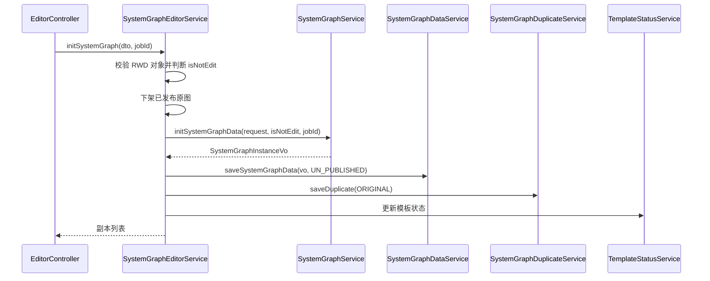

# 生成、编辑与发布

关系图生命周期围绕 `SystemGraphDuplicate` 展开：初始化生成原图，复制出副本，编辑未发布副本，发布其中一个副本，下架或删除不再使用的副本。

## 初始化图纸

入口：`POST /systemGraphEditor/initSystemGraph`

主流程位于 `SystemGraphEditorServiceImpl#initSystemGraph`：

1. 从请求中读取 `referenceObjectId` 和 `graphTypeCode`。
2. 通过 `DtpRwdClientService#getObject` 校验基准对象存在。
3. 根据 `CommonConfigService#getGraphConfig` 和 `SystemGraphService#getGraphName` 判断当前图是否 `isNotEdit`。
4. 构造新的 `RequestSystemGraphDTO`：
   - `referenceObjectId` 为基准对象。
   - `graphTypeCode` 为请求图类型。
   - `attachEnable=true`，启用已配置小附件。
   - `attachShowAll=false`，不展示全量调试小附件。
   - `cacheRead=false`，初始化不读缓存。
5. 查询当前系统对象和图类型下已发布副本，如果存在已发布原图，则先下架原图。
6. 调用 `SystemGraphService#initSystemGraphData` 生成 `SystemGraphInstanceVo`。
7. 调用 `SystemGraphDataService#saveSystemGraphData` 保存压缩 JSON，状态为 `UN_PUBLISHED`。
8. 调用 `SystemGraphDuplicateService#saveDuplicate` 创建 `ORIGINAL` 副本。
9. 调用 `SystemGraphTemplateStatusService#updateTemplateStatusByObjectIdAndGraphCodeType` 清除模板更新标识。
10. 如果图不可编辑且之前已有发布副本，则自动发布新原图。
11. 返回该系统对象和图类型下的副本列表。

## ADM 生成数据装配

`SystemGraphServiceImpl#initSystemGraphData` 负责从 ADM 生成数据转成本系统 VO：

- 预加载本地图例 `GraphLegendService#getGraphLegendMap` 和图标 `GraphIconService#getGraphIconMap`。
- 通过 RWD 查询基准对象，结合 `GRAPH_CONFIG` 推导图名称。
- 调用 ADM 关系图服务生成 `GraphGenerateInstanceDto`。
- 给设备、设备组、小附件匹配图例、条件图标、固定标签、抽屉信息点和面板信息点。
- 对 `packNode` 设置区域样式 `Area001`。
- 如果设备、设备组和小附件都为空，则抛出业务异常。

生成结果会作为 `SystemGraphData.data` 的压缩 JSON 保存，后续编辑和运行态都以此为基础。

## 副本复制

入口：`POST /systemGraphEditor/createSystemGraphDuplicate/{duplicateId}`

`SystemGraphDuplicateServiceImpl#createSystemGraphDuplicate` 的约束：

- 目标副本不存在时抛出异常。
- 原图且 `isNotEdit=true` 时不能创建副本。
- 同一系统对象和图类型下 `COPY` 副本数量超过限制时抛出异常；当前代码判断为 `list(queryWrapper).size() > 5`。
- 复制时克隆 `SystemGraphData`，创建新的 `COPY` 副本，并复制原副本的 `SystemGraphDetail`。

## 重新计算管线

入口：`POST /systemGraphEditor/recalculatePipeline/{duplicateId}`

`SystemGraphEditorServiceImpl#recalculatePipeline` 的约束：

- 副本必须存在。
- `isNotEdit=true` 的图不能计算管线。
- `PUBLISHED` 状态的图不能计算管线。
- `dto.generateId` 非空时设置 `cacheRead=true`，否则不读缓存。

重算前会调用 `SystemGraphGenerateParameterService#saveAndUpdateSystemGraphGenerateParameter` 保存或合并参数，再按保存后的参数重新生成图纸数据。重算成功后创建新的 `SystemGraphData`，并把副本的 `systemGraphDataId` 指向新数据；旧图纸数据会被删除。

## 编辑图纸主体

入口：`POST /systemGraphEditor/editSystemGraph/{duplicateId}`

编辑入口会先检查副本状态，已发布图不能编辑。真正更新逻辑在 `SystemGraphDataServiceImpl#editSystemGraph`：

- 使用 Redisson 锁 `updateSystemGraphDataLock` 避免并发写。
- 解压 `SystemGraphData.data` 为 JSON。
- 按 `EnumUpdateGraphType` 更新：
  - `EQ` 更新 `equipmentNodeVos`。
  - `PASSBY` 更新 `passByVos`。
  - `GROUP` 更新 `groupVos`。
  - `CUSTOMIZE` 更新 `customizeContent`。
- 对 `compType == "packNode"` 的节点跳过字段更新。
- 通过 `dataObjectId == dto.objectId` 匹配节点，并把 `dto.code` 字段设置为 `dto.data`。
- 设置 `isUpdateDetail=true` 后重新压缩保存。

维护时注意：锁释放在 `finally` 中执行，当前代码无论是否成功获取锁都会调用 `unlock()`；如果调整锁逻辑，需要同时检查未持有锁释放的异常风险。

## 细节调整

细节调整独立存入 `system_graph_detail`，不直接混入压缩图纸主体。编辑器读取时通过 `getSystemGraphData(duplicateId, true)` 一并返回。

常用入口：

- `saveAndUpdateSystemGraphDetail`
- `saveAndUpdateSystemGraphDetailBatch`
- `deleteSystemGraphDetail`
- `getSystemGraphDetailById`
- `copyDetailData`

这种设计让前端可以区分“图纸主体结构变更”和“局部样式、标签、信息点等细节调整”。

## 发布图纸

入口：`POST /systemGraphEditor/publishSystemGraph/{duplicateId}`

`SystemGraphDuplicateServiceImpl#publishSystemGraph` 的流程：

1. 校验副本存在且不是已发布状态。
2. 查询同 `systemObjectId + graphTypeCode + classCode` 的所有副本。
3. 将其他已发布副本改回 `UN_PUBLISHED`，并同步其 `SystemGraphData.status`。
4. 将当前副本改为 `PUBLISHED`。
5. 查询 `SystemGraph` 发布入口：
   - 不存在则新增。
   - 存在则更新 `systemGraphDuplicateId` 和 `graphName`。
6. 当前副本的数据状态更新为 `PUBLISHED`。

发布后的运行态入口是 `SystemGraph.id`，不是 `SystemGraphDuplicate.id`。

## 下架和删除

下架入口：`POST /systemGraphEditor/offlineSystemGraph/{duplicateId}`

- 只有 `PUBLISHED` 状态的副本可以下架。
- 下架会把副本状态改为 `OFF_LINE`。
- 同时把对应 `SystemGraph.systemGraphDuplicateId` 清空。

删除入口：`POST /systemGraphEditor/deleteSystemGraphDuplicate/{duplicateId}`

- 已发布图不能删除。
- 删除时移除副本关联的 `SystemGraphData`，再删除副本记录。

下架保留副本记录，删除会移除副本和图纸数据；两者语义不同。
