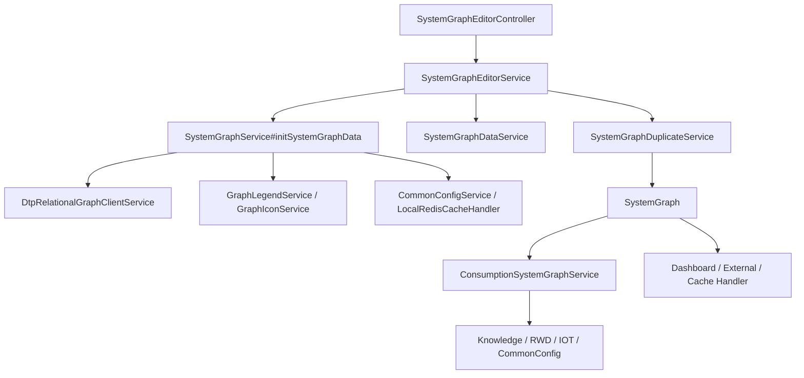

# 模块总览

关系图模块提供“生成一张图、编辑多个副本、发布一个当前图、运行态按发布图查询”的能力。它把 ADM 关系图服务生成的模板实例数据转换为本系统可消费的 `SystemGraphInstanceVo`，并在编辑器、运行态页面、Dashboard、外部接口和本地缓存之间复用同一套发布结果。

## 模块职责

- 查询图纸展示配置、菜单配置、管线样式、图标滤镜、交互配置、系统运行参数和异常事件配置。
- 从 ADM/RWD 生成关系图实例数据，并落库为未发布图纸数据。
- 维护同一个系统对象和图类型下的原图、副本、发布状态和下架状态。
- 支持未发布副本的图纸编辑、管线重算、细节调整、名称调整和细节复制。
- 发布副本后写入 `system_graph` 当前图入口，供运行态和外部查询消费。
- 运行态查询时补充图例图标、管线样式、固定标签、信息点值、滤镜状态、抽屉信息点和交互配置。
- 管理图例和条件图标，支持从 ADM 资源库同步并维护本地文件地址。
- 为 Dashboard、外部系统、运行监控和本地缓存提供图内对象集合。

## 模块边界

| 边界 | 说明 |
| --- | --- |
| 展示查询边界 | `SystemGraphController` 面向前端运行态页面和配置读取，主要路径为 `/system/graph`。 |
| 编辑器边界 | `SystemGraphEditorController` 面向图纸生成、编辑、副本、发布、下架和细节调整，主要路径为 `/systemGraphEditor`。 |
| 生成边界 | `SystemGraphService#initSystemGraphData` 调用 ADM 关系图服务生成图纸，并补充图例、固定标签、信息面板等数据。 |
| 编辑副本边界 | `SystemGraphDuplicateService` 管理副本状态、复制、发布互斥和当前发布图指针。 |
| 数据边界 | `SystemGraphDataService` 负责压缩 JSON 保存和编辑更新。 |
| 运行态边界 | `ConsumptionSystemGraphService` 负责发布图查询后的运行态加工。 |
| 资源库边界 | `GraphLegendService` 和 `GraphIconService` 管理图例、条件图标和文件 URL。 |
| 外部联动边界 | `DashboardSystemGraphService`、`SystemGraphExternalService`、`SystemRelationGraphHandler` 复用发布图元数据。 |

## 核心包结构

```text
common/src/main/java/com/persagy/apccontrol/basic
├── controller
│   ├── systemgraph
│   ├── dashboard
│   └── outside
├── service
│   ├── systemgraph
│   │   └── impl
│   ├── dashboard
│   └── common
├── model
│   ├── dto/systemgraph
│   ├── dto/systemgraph/adm
│   ├── entity/systemgraph
│   ├── enumtype/systemgraph
│   └── vo/systemgraph
├── mapper/systemgraph
├── resource
└── handler
```

SaaS 侧图例图标管理入口：

```text
saas/meos-control-server/src/main/java/com/persagy/apccontrol/controller/graph
├── GraphLegendController.java
└── GraphIconController.java
```

## 总体关系



## 主干设计

关系图的主干设计是“副本承载编辑态，发布入口承载运行态”。生成和编辑时，前端操作的是 `SystemGraphDuplicate` 对应的 `SystemGraphData`；发布时，系统把同一系统对象、同一图类型、同一类编码下其他已发布副本退回未发布，再把当前副本标记为已发布，并将 `SystemGraph.systemGraphDuplicateId` 指向当前副本。

运行态查询不直接返回压缩 JSON 原文，而是在 `ConsumptionSystemGraphService#querySystemGraphById` 中继续补齐动态数据。这样编辑器数据可以保持相对稳定，运行态页面每次按当前配置、规则和 IOT 数据重新加工。
