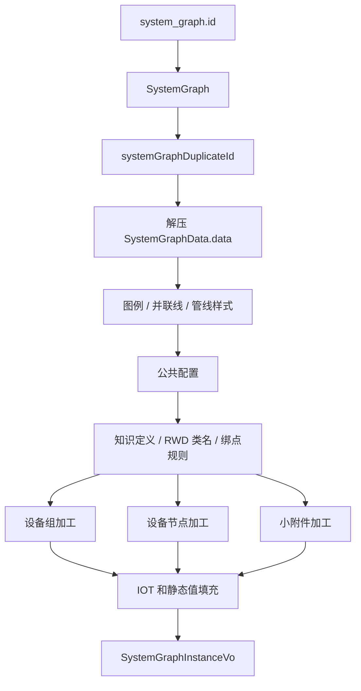

# 运行态数据加工

运行态查询入口为 `GET /system/graph/instance/{id}`，其中 `id` 是 `system_graph.id`。查询后的数据不是简单解压返回，而是会按照当前配置、知识定义、RWD 对象、IOT 值和业务规则重新加工。

## 查询主流程

主流程位于 `ConsumptionSystemGraphService#querySystemGraphById`：

1. 按 `system_graph.id` 查询 `SystemGraph`。
2. 校验 `systemGraphDuplicateId` 不为空。
3. 调用 `SystemGraphEditorService#getSystemGraphData(duplicateId, false)` 读取图纸数据。
4. 编辑器服务内部解压 `SystemGraphData.data`，补充图例图标，并匹配并联线和管线样式。
5. 读取 `GRAPH_CONFIG` 和 `SYSTEM_GRAPH_FILTER_STATUS` 等公共配置。
6. 根据图配置计算 `graphName` 和 `displayMode`。
7. 收集设备、设备组、小附件涉及的所有 `classCode`。
8. 并发查询：
   - 知识信息点定义：`DtpKnowledgeClientService#mapClassCodeInfoCodeAndDefine`
   - 类编码名称：`DtpKnowledgeClientService#mapClassCodeAndName`
   - 对象绑点规则：`AbstractCommonServer#queryObjectsExistRuleMap`
9. 加工设备组、设备节点和小附件。
10. 批量查询 IOT 信息点值，并填充固定标签、抽屉、面板和文本框。
11. 返回加工后的 `SystemGraphInstanceVo`。

## 图例、并联线和管线样式

运行态读取副本数据时，`SystemGraphEditorService#getSystemGraphData` 会先执行三步：

- `abstractGraphLegendServer.initGraphLegendAndIcons(vo)`：初始化图例和图标。
- `systemGraphService.matchParallelLines(vo)`：匹配并联线组。
- `systemGraphService.matchPipeLineStyle(vo)`：匹配管线样式，包括母线、立管等。

这部分发生在运行态补值之前，因此后续节点加工能基于完整图例和管线结构继续处理。

## 设备组加工

`processGroupVos` 会处理设备组固定标签、滤镜状态和信息点值。设备组类编码来自 `GraphGroupVo.dataObject.classCode`。对于需要展示设备组运行数量和异常事件数量的类，固定标签由 `SystemGraphService#buildFixedLabelByGroup` 组装。

组节点最终会写回：

- `fixedInfoCodes`
- `filterStatusVO`
- `filterStatus`
- `textMap` 中的信息点值

## 设备节点加工

`processEquipmentVos` 是运行态最重的加工环节。每个设备节点会补充：

| 字段 | 来源 |
| --- | --- |
| `className` | 知识库类编码名称。 |
| `interactiveConfigVo` | `CommonConfigService#getInteractiveConfig` 与图名称匹配。 |
| `filterStatusVO` / `filterStatus` | `SYSTEM_GRAPH_FILTER_STATUS` 与对象绑点规则匹配。 |
| `fixedInfoCodes` | `GRAPH_INFORMATION` 和对象绑点规则。 |
| `drawerAllInfoCodes` | `LocalRedisCacheHandler#mapListInfoCodeConfigs`。 |
| `panelNode` | `SystemGraphService#buildPanelNodeInformationList`。 |

对于供冷、供热、空调总览图的源端供水关系图，`packNode` 还有额外交互逻辑：例如补水泵可生成“冷冻水补水监测图”的跳转配置，控制分区可生成“末端供水关系图”的跳转配置。

锚点关联对象也会被检查是否存在供电关系图：如果存在已发布图，则在锚点对象中补充 `canJump`、`systemObjectId`、`interactiveObjectCode`、`graphTypeCode`、`graphName`。

## 小附件加工

小附件节点来自 `passByVos`。运行态会：

- 调用 `SystemGraphService#buildFixedLabelByPassBy` 构建固定标签。
- 按滤镜配置和绑点规则计算 `filterStatusVO`。
- 和设备节点一起参与 IOT 信息点值批量查询。

固定小附件信息点列表当前由 `SystemGraphService.FIXED_PASSBY_INFOCODE_LIST` 定义，主要包含 `online_status`。

## 信息点值填充

`getInfoCodeValues` 会从设备节点、小附件节点中收集所有对象 ID 和信息点编码，包括：

- 固定标签 `fixedInfoCodes`
- 抽屉信息点 `drawerAllInfoCodes`
- 面板信息点 `panelNode.infoCodes`
- 文本框 `textMap` 中的 `textCode`

动态值通过 `AbstractIotDataCacheServer#listInfoCodeValueInOneHour` 查询。静态信息点则从 RWD 对象 `undefinedProperties` 取值。填充逻辑会把无定义或无值的静态信息点移除。

## 未加工数据查询

`ConsumptionSystemGraphService#querySystemGraphDataNoProcess` 只读取发布副本并解压 `SystemGraphData.data`，不做图例、信息点、滤镜和交互加工。它主要用于关系图对象解析和缓存联动，避免运行态补值开销。

维护时需要区分：

- 页面展示：使用 `querySystemGraphById`。
- 只解析图内对象：使用 `querySystemGraphDataNoProcess`。
