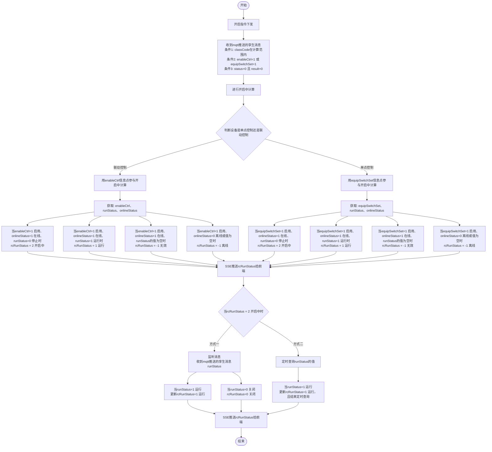
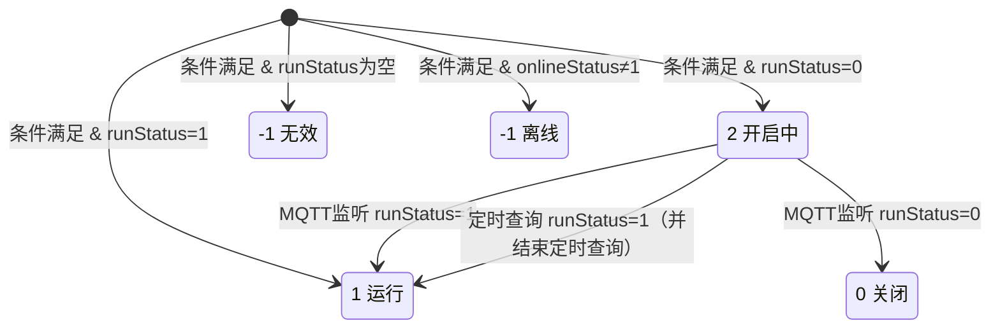

# rcRunStatus 计算逻辑 - 产品文档业务流程详解

> **文档来源**: 产品设计/rcRunStatus计算逻辑.png  
> **文档用途**: 作为 rcRunStatus 计算逻辑的权威产品需求文档，用于指导开发和测试  
> **创建时间**: 2026-04-15

---

## 目录

1. [概述](#1-概述)
2. [完整业务流程图](#2-完整业务流程图)
3. [流程详细说明](#3-流程详细说明)
4. [判断节点详解](#4-判断节点详解)
5. [状态计算规则](#5-状态计算规则)
6. [开启中状态的后续处理](#6-开启中状态的后续处理)
7. [状态转换矩阵](#7-状态转换矩阵)

---

## 1. 概述

### 1.1 文档目的

本文档将产品设计流程图严格转换为详细的文字描述，明确 rcRunStatus（设备运行状态）的计算逻辑，内容与流程图完全一致，包括：

- 完整的业务流程步骤
- 各个判断节点的条件和分支
- 单点控制与联动控制的状态计算规则
- 开启中状态的两种后续处理机制

> **范围说明**: 产品流程图描述的是**开启指令下发**后的处理流程，关闭指令流程图中未涉及。

### 1.2 rcRunStatus 状态定义

| 状态值  | 状态名称    | 说明                   |
|------|---------|----------------------|
| `-1` | 无效 / 离线 | 设备离线，或 runStatus 值为空 |
| `0`  | 关闭      | 设备已关闭                |
| `1`  | 运行      | 设备正常运行中              |
| `2`  | 开启中     | 设备正在启动（过渡状态）         |

### 1.3 核心信息点

| 信息点              | 含义           | 取值说明                     |
|------------------|--------------|--------------------------|
| `classCode`      | 设备类型代码       | 字符串，用于判断是否在计算范围内         |
| `enableCtrl`     | 启用控制（联动控制）   | `1` = 启用，其他 = 未启用        |
| `equipSwitchSet` | 设备开关设置（单点控制） | `1` = 开启，其他 = 未开启        |
| `runStatus`      | 实际运行状态       | `1` = 运行，`0` = 停止，空 = 无值 |
| `onlineStatus`   | 设备在线状态       | `1` = 在线，`0` = 离线，空 = 无值 |
| `status`         | 消息的指令执行状态    | `0` = 开始执行               |
| `result`         | 消息的指令执行结果    | `0` = 进行中                |

---

## 2. 完整业务流程图



---

## 3. 流程详细说明

### 3.1 第一阶段：开启指令下发

**流程起点**：系统向设备下发开启指令。

---

### 3.2 第二阶段：接收 MQTT 消息并进行条件过滤

系统收到 mqtt 推送的孪生消息后，必须**同时满足以下三个条件**，才能进入后续的"开启中"计算流程。

#### 条件 1：classCode 在计算范围内

- **含义**：设备的类型代码必须在系统配置的 rcRunStatus 计算范围内
- **目的**：只对需要计算运行状态的设备类型进行处理

#### 条件 2：enableCtrl=1 启用 或 equipSwitchSet=1 开启

- **含义**：设备处于联动控制启用状态，或处于单点控制开启状态
- **逻辑**：满足任意一个即可（OR 关系）

#### 条件 3：消息的 status=0 且 result=0

- **含义**：消息中携带的指令状态为"开始执行"，执行结果为"进行中"
- **字段**：
    - `status=0`：开始执行
    - `result=0`：进行中
- **目的**：只处理设备启动过程中的进行中状态消息

> **重要说明**：三个条件必须**全部满足**，才能继续执行后续流程。若任意条件不满足，则不进行 rcRunStatus 计算。

---

### 3.3 第三阶段：进行"开启中"计算

三个条件全部满足后，进入"开启中"计算流程。

#### 3.3.1 判断设备是单点控制还是联动控制

根据判断结果，选择不同的信息点参与计算：

| 控制方式 | 参与计算的信息点         |
|------|------------------|
| 联动控制 | `enableCtrl`     |
| 单点控制 | `equipSwitchSet` |

#### 3.3.2 联动控制路径

**获取信息点**：`enableCtrl`、`runStatus`、`onlineStatus`

**计算分支**（共 4 个，与流程图一一对应）：

| 分支  | enableCtrl | onlineStatus | runStatus | rcRunStatus | 状态说明 |
|-----|------------|--------------|-----------|-------------|------|
| 分支1 | 1（启用）      | 1（在线）        | 0（停止）     | **2**       | 开启中  |
| 分支2 | 1（启用）      | 1（在线）        | 1（运行）     | **1**       | 运行   |
| 分支3 | 1（启用）      | 1（在线）        | 值为空       | **-1**      | 无效   |
| 分支4 | 1（启用）      | 0（离线）或值为空    | —         | **-1**      | 离线   |

#### 3.3.3 单点控制路径

**获取信息点**：`equipSwitchSet`、`runStatus`、`onlineStatus`

**计算分支**（共 4 个，与流程图一一对应）：

| 分支  | equipSwitchSet | onlineStatus | runStatus | rcRunStatus | 状态说明 |
|-----|----------------|--------------|-----------|-------------|------|
| 分支1 | 1（启用）          | 1（在线）        | 0（停止）     | **2**       | 开启中  |
| 分支2 | 1（启用）          | 1（在线）        | 1（运行）     | **1**       | 运行   |
| 分支3 | 1（启用）          | 1（在线）        | 值为空       | **-1**      | 无效   |
| 分支4 | 1（启用）          | 0（离线）或值为空    | —         | **-1**      | 离线   |

> **观察**：单点控制与联动控制的计算规则完全相同，区别仅在于使用的控制信息点不同（`equipSwitchSet` vs `enableCtrl`）。

---

### 3.4 第四阶段：SSE 推送

计算完成后，**立即通过 SSE（Server-Sent Events）将 rcRunStatus 推送给前端**。

无论计算结果为哪种状态（2、1、-1），都执行推送。

---

## 4. 判断节点详解

### 4.1 条件过滤节点

**流程图位置**：第二步

**判断逻辑**：三个条件的逻辑与（AND）关系

```
条件1 AND 条件2 AND 条件3
↓
全部满足 → 进入"开启中"计算
任一不满足 → 流程结束
```

### 4.2 控制方式判断节点

**流程图位置**：进入"开启中"计算后的菱形判断节点

**判断内容**：设备是**单点控制**还是**联动控制**

**分支结果**：

```
联动控制 → 用 enableCtrl 信息点参与"开启中"计算
单点控制 → 用 equipSwitchSet 信息点参与"开启中"计算
```

> **说明**：产品流程图中此节点有明确的两个分支出口，分别标注"联动控制"和"单点控制"。

### 4.3 开启中状态后续处理节点

**流程图位置**：SSE 推送之后

**触发条件**：`rcRunStatus = 2`（开启中）

**处理方式**：同时通过两条路径监控状态变化（见第 6 节）

---

## 5. 状态计算规则

### 5.1 计算优先级

根据流程图，状态计算的判断优先级如下（以联动控制为例，单点控制相同）：

```
1. 判断 onlineStatus
   - onlineStatus ≠ 1（离线或值为空）→ rcRunStatus = -1（离线）
   
2. onlineStatus = 1 时，判断 runStatus
   - runStatus = 0（停止）→ rcRunStatus = 2（开启中）
   - runStatus = 1（运行）→ rcRunStatus = 1（运行）
   - runStatus 值为空    → rcRunStatus = -1（无效）
```

### 5.2 完整计算公式

**联动控制**（enableCtrl=1 为前提）：

```
if onlineStatus != 1:
    rcRunStatus = -1    # 离线（onlineStatus=0 或值为空）
elif runStatus == nil:
    rcRunStatus = -1    # 无效（runStatus 值为空）
elif runStatus == 0:
    rcRunStatus = 2     # 开启中
elif runStatus == 1:
    rcRunStatus = 1     # 运行
```

**单点控制**（equipSwitchSet=1 为前提）：

```
if onlineStatus != 1:
    rcRunStatus = -1    # 离线（onlineStatus=0 或值为空）
elif runStatus == nil:
    rcRunStatus = -1    # 无效（runStatus 值为空）
elif runStatus == 0:
    rcRunStatus = 2     # 开启中
elif runStatus == 1:
    rcRunStatus = 1     # 运行
```

---

## 6. 开启中状态的后续处理

当第一次计算结果为 `rcRunStatus = 2`（开启中）时，系统通过**两种方式**并行监控设备状态变化。

### 6.1 方式一：监听消息（MQTT）

**监听内容**：收到 mqtt 推送的孪生消息（runStatus）

**处理规则**：

| runStatus 取值 | 操作                    | 结果        |
|--------------|-----------------------|-----------|
| `1`（运行）      | 更新 rcRunStatus = 1 运行 | SSE 推送给前端 |
| `0`（关闭）      | rcRunStatus = 0 关闭    | SSE 推送给前端 |

### 6.2 方式二：定时查询 runStatus 的值

**查询机制**：定时查询设备的 runStatus 值

**处理规则**：

| runStatus 取值 | 操作                                | 说明      |
|--------------|-----------------------------------|---------|
| `1`（运行）      | 更新 rcRunStatus = 1 运行，**且结束定时查询** | 流程图明确标注 |

> **说明**：流程图中定时查询分支仅明确描述了 runStatus=1 时的处理（更新状态并结束定时查询）。

### 6.3 状态更新后的推送

无论通过哪种方式触发状态更新，最终都通过 **SSE 推送 rcRunStatus 给前端**。

---

## 7. 状态转换矩阵

### 7.1 第一次计算结果（条件满足后）

| 控制方式  | onlineStatus | runStatus | rcRunStatus | 状态名称 |
|-------|--------------|-----------|-------------|------|
| 联动/单点 | 1（在线）        | 0（停止）     | **2**       | 开启中  |
| 联动/单点 | 1（在线）        | 1（运行）     | **1**       | 运行   |
| 联动/单点 | 1（在线）        | 值为空       | **-1**      | 无效   |
| 联动/单点 | 0（离线）或值为空    | —         | **-1**      | 离线   |

### 7.2 开启中状态的后续转换

| 当前状态   | 触发方式    | 触发条件          | 新状态              |
|--------|---------|---------------|------------------|
| 2（开启中） | MQTT 监听 | runStatus = 1 | **1**（运行）        |
| 2（开启中） | MQTT 监听 | runStatus = 0 | **0**（关闭）        |
| 2（开启中） | 定时查询    | runStatus = 1 | **1**（运行），结束定时查询 |

### 7.3 状态转换图



---

## 附录

### 附录 A：术语表

| 术语             | 说明                                 |
|----------------|------------------------------------|
| 孪生消息           | 设备状态的虚拟映射消息，通过 MQTT 推送             |
| SSE            | Server-Sent Events，服务器向前端推送实时事件的技术 |
| MQTT           | 轻量级消息队列协议，用于接收设备状态推送               |
| classCode      | 设备类型代码，用于判断设备是否在计算范围内              |
| rcRunStatus    | 设备运行状态，由本流程计算得出                    |
| enableCtrl     | 联动控制启用状态信息点                        |
| equipSwitchSet | 单点控制开关设置信息点                        |
| runStatus      | 设备实际运行状态信息点                        |
| onlineStatus   | 设备在线状态信息点                          |

### 附录 B：流程图关键节点索引

| 节点编号    | 节点类型 | 节点描述                                      |
|---------|------|-------------------------------------------|
| N1      | 起始   | 开始                                        |
| N2      | 操作   | 开启指令下发                                    |
| N3      | 操作   | 收到 mqtt 推送的孪生消息（含三个条件过滤）                  |
| N4      | 操作   | 进行"开启中"计算                                 |
| N5      | 判断   | 判断设备是单点控制还是联动控制                           |
| N6a     | 操作   | 用 enableCtrl 信息点参与"开启中"计算（联动路径）           |
| N6b     | 操作   | 用 equipSwitchSet 信息点参与"开启中"计算（单点路径）       |
| N7a     | 操作   | 获取：enableCtrl、runStatus、onlineStatus      |
| N7b     | 操作   | 获取：equipSwitchSet、runStatus、onlineStatus  |
| N8~N11  | 结果   | 联动控制的 4 个计算分支结果                           |
| N12~N15 | 结果   | 单点控制的 4 个计算分支结果                           |
| N16     | 操作   | SSE 推送 rcRunStatus 给前端                    |
| N17     | 条件   | 当 rcRunStatus=2 开启中时                      |
| N18     | 操作   | 监听消息（收到 mqtt 推送的孪生消息 runStatus）           |
| N19     | 操作   | 定时查询 runStatus 的值                         |
| N20     | 结果   | runStatus=1 → 更新 rcRunStatus=1 运行         |
| N21     | 结果   | runStatus=0 → rcRunStatus=0 关闭            |
| N22     | 结果   | runStatus=1 → 更新 rcRunStatus=1 运行，且结束定时查询 |
| N23     | 操作   | SSE 推送 rcRunStatus 给前端                    |
| N24     | 终止   | 结束                                        |

---

**文档版本**: v2.0  
**最后更新**: 2026-04-15  
**文档状态**: ✅ 已按产品流程图严格重构  
**重构说明**:

- v2.0: 完全依据产品流程图图片重构，删除所有代码分析内容，仅保留流程图所描述的业务需求
    - 删除"现有代码中的特殊设备处理"章节（产品图未涉及）
    - 删除"控制方式判断规则"章节（产品图无待确认内容）
    - 删除"待确认问题清单"（非产品图内容）
    - 流程图、状态表格、计算公式严格与产品图对齐
    - 补充"流程图关键节点索引"附录，便于 AI 分析和追溯
